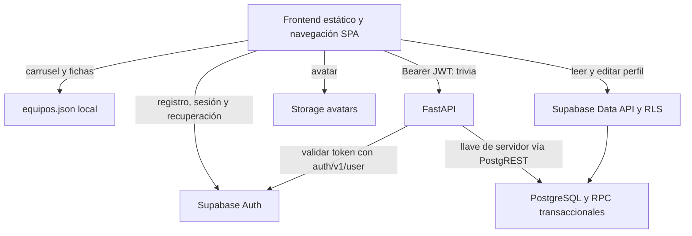

# Auditoría técnica y funcional integral — Zona Diamante

Fecha: 24 de octubre de 2026, zona horaria de referencia `America/Mexico_City`.

Fuente principal: archivos reales de la copia de trabajo de `D:\projects\zona-diamante`, incluidos los cambios sin commit. Rama: `feat/collection-cards`. HEAD: `6db8b37` (`Corrige animacion al entrar a la seccion de Juego`). No se realizaron modificaciones de código, instalaciones, actualizaciones, commits, migraciones ni despliegues. Este documento es el único archivo de entrega añadido; el build regeneró sus salidas públicas ignoradas por Git.

## 1. Resumen ejecutivo

**El proyecto tiene una base técnica aprovechable, pero todavía no está listo para entregarse como plataforma completa.** La navegación, las fichas de cuatro equipos, las galerías y los filtros visuales de video tienen implementación real. Auth, perfiles y trivia cuentan con integración con Supabase y FastAPI. La colección visible y el juego siguen siendo demostraciones, y AR todavía no concede recompensas persistentes.

Resultados principales:

- Pasaron **43 pruebas del backend**, **38 del frontend** y el **build completo del frontend**. Son pruebas principalmente unitarias y de contratos con dobles; no certifican las transacciones SQL ni un recorrido autenticado real. Sólo **14 de las 38 pruebas del frontend** están en archivos versionados; las otras 24 dependen de cinco archivos locales ignorados.
- La colección muestra **cuatro cartas fijas**, sin saldo, precios, compra ni propiedad individual. Localmente existen API, modelos y migraciones para un catálogo de **20 cartas**, pero esos archivos aún no están añadidos a Git y el frontend no los consume.
- El backend público configurado por el frontend usa un dominio de Render. En comprobaciones GET sin credenciales, `/health` respondió **200**, `/api/v1/me` y `/api/v1/trivia/daily` respondieron **401**, y `/api/v1/cards` respondió **404**. La colección publicada conserva las cuatro cartas estáticas. Existencia local y disponibilidad publicada son estados distintos.
- El juego consiste en una imagen y un listener de un solo clic que abre “¡Ganaste!”. Pulsar **Pausar también abre la victoria**, comprobado en navegador. No hay motor de juego, derrota, reglas de puntuación ni recompensa real.
- AR reconoce índices de cuatro equipos, presenta modelos y tiene captura, previsualización, descarga y compartir. **Reclamar sólo lanza confeti**. No hay endpoint, validación de evidencia ni transacción de desbloqueo AR.
- Hay un **bloqueo de reconstrucción desde cero inferido del SQL**: la migración de cartas exige 20 filas obtenidas mediante un join con `teams`, pero esos equipos se insertan en `seed.sql`, que se ejecuta después de las migraciones.
- Hay **riesgos altos de colisión de claves de idempotencia** entre compras y trivia: la compra acepta una clave global arbitraria del cliente y la finalización genérica no distingue correctamente un `attempt_id` nulo ni comprueba el tipo del evento en su rama de repetición. Requiere corrección y reproducción SQL antes de conectar la compra a la UI.
- No se confirmó una vulnerabilidad **Crítica** que permita obtener puntos arbitrarios con las rutas actuales. Sí hay bloqueadores altos de entrega y riesgos de integridad/disponibilidad. No debe interpretarse la ausencia de un hallazgo crítico confirmado como certificación de seguridad.

La prioridad es completar la cadena **sesión → trivia/puntos → colección/compra → AR/mascotas**, resolver la reconstrucción SQL y definir el juego y los partidos. No se justifica reescribir el proyecto.

### Alcance y grado de certeza

En este reporte se diferencia:

- **Observado:** lectura directa de código, configuración, Git o contenido público.
- **Probado:** comando ejecutado o interacción local en navegador; se indica su alcance.
- **Inferido:** consecuencia razonada del código que no se reprodujo con la infraestructura real.
- **No verificado:** comportamiento que requiere cuenta de pruebas, cámara física, PostgreSQL/Supabase o acceso operativo a los proveedores.

Docker Desktop no tenía disponible su motor Linux. No se levantó Supabase ni se ejecutó SQL. No se utilizaron cuentas reales, tokens de usuario, correos de recuperación, compras ni cambios de perfil. No se inspeccionaron datos remotos, historial de migraciones aplicado, políticas efectivas del proyecto remoto, configuración del panel de Render/Netlify ni logs de producción. Se leyeron únicamente páginas públicas y endpoints GET sin autenticación. No se publican valores de `.env` ni de la configuración pública generada.

## 2. Arquitectura actual

### 2.1 Estructura y responsabilidades

```text
zona-diamante/
├── README.md                         Ejecución local y descripción general
├── package.json / package-lock.json   Supabase CLI para herramientas locales
├── docs/
│   ├── plan-backend-supabase.md       Plan histórico; no representa el estado actual
│   └── auditoria-general-zona-diamante.md
├── frontend/
│   ├── package.json / package-lock.json
│   ├── scripts/
│   │   ├── supabase-entry.mjs         Entrada del bundle del SDK
│   │   └── generate-runtime-config.cjs
│   ├── src/css/                      Tailwind y diseño común/Auth
│   ├── public/
│   │   ├── index.html                Inicio
│   │   ├── pages/
│   │   │   ├── auth/                 Login, registro, recuperar, restablecer, perfil
│   │   │   ├── experiencias/         Shell AR, trivia y juego
│   │   │   ├── ar/ar-vista.html      Documento aislado con MindAR/A-Frame
│   │   │   ├── equipos/equipo.html   Ficha dinámica por ?id=<slug>
│   │   │   ├── coleccion/            Colección estática actual
│   │   │   ├── contenido/            Historia y ayuda
│   │   │   └── demos/                Una página vacía y un HTML de prueba
│   │   ├── js/
│   │   │   ├── app/                 Rutas, arranque, navegación SPA, config generada
│   │   │   ├── components/          Header, menú inferior y carrusel
│   │   │   ├── services/            Cliente Supabase y proveedor de equipos
│   │   │   ├── api/                 Cliente HTTP autenticado y cliente de trivia
│   │   │   └── features/            Controladores por funcionalidad
│   │   ├── css/                     CSS por página y output.css generado
│   │   ├── data/equipos.json        Fuente activa del contenido de equipos
│   │   ├── ar/                      targets.mind y modelos GLB
│   │   ├── assets/                  Fotos, cartas, fuentes, iconos y créditos
│   │   └── vendor/                  A-Frame/MindAR y SDK Supabase generado
│   ├── checks/                      Pruebas versionadas de equipos y revisión visual
│   ├── tests/                       Mezcla de pruebas versionadas e ignoradas
│   └── docs/                        Contratos Auth, fichas y animaciones 3D
├── backend/
│   ├── app/
│   │   ├── main.py                  FastAPI, CORS y registro de routers
│   │   ├── api/routes/              health, me, attempts, rewards, trivia, cards
│   │   ├── core/                    Settings, autenticación y logging
│   │   ├── db/supabase.py           Acceso HTTP a PostgREST con llave de servidor
│   │   ├── schemas/                 Contratos Pydantic
│   │   └── services/                Intentos, recompensas, trivia y cartas
│   ├── tests/                       Contratos HTTP y servicios con dobles
│   ├── requirements.txt            Dependencias Python fijadas
│   └── Dockerfile                  Python 3.12 y Uvicorn, variable PORT
└── supabase/
    ├── config.toml                  Entorno local Auth, DB, Storage y servicios
    ├── migrations/                  18 migraciones SQL presentes localmente
    ├── seed.sql                     Cuatro equipos de desarrollo
    └── tests/database/              14 aserciones pgTAP de esquema/permisos básicos
```

`backend/venv`, `node_modules`, `.tmp` y las cachés son herramientas o residuos locales; no son módulos del producto. Git avisó de acceso denegado a la caché `.pytest_cache` de la raíz. No se modificaron sus permisos ni se eliminó.

### 2.2 Tecnologías comprobadas

| Área | Estado observado |
| --- | --- |
| UI | HTML, CSS y módulos ES nativos. No hay React/Vue ni router de framework. |
| CSS | Tailwind CSS/CLI 4.3.3 instalado; CSS específico adicional por página. |
| Build | Tailwind + esbuild 0.28.2 para el SDK Supabase + generación de runtime config. No empaqueta toda la aplicación. |
| SDK navegador | `@supabase/supabase-js` 2.117.2, con persistencia, renovación automática y detección de sesión en URL. |
| AR | A-Frame y MindAR servidos como archivos vendor; uso de THREE a través de AFRAME. |
| API | FastAPI 0.141.1, Uvicorn 0.52.4, pydantic-settings 2.15.0, HTTPX 0.28.1. |
| Datos | PostgreSQL/Supabase mediante SQL versionado y PostgREST. No hay ORM ni conexión SQL directa en el código de aplicación. |
| Auth/Storage | Integración real del SDK con Auth, `profiles` y bucket `avatars`. No hay almacenamiento de fotos AR en Storage. |
| Hosting | Frontend público en Netlify según README y respuesta HTTPS; backend público configurado con hostname de Render. Configuración interna del hosting no inspeccionada. |
| Herramientas locales | Node 24.19.0; Python del venv 3.12.14; Supabase CLI declarada `^2.118.0`. El README propone Python 3.13, pero el Dockerfile usa 3.12. |

### 2.3 Flujo real de datos



El navegador obtiene el access token con `supabase.auth.getSession()` y lo envía como Bearer a FastAPI. El backend **no se limita a decodificar un JWT**: consulta `/auth/v1/user` y toma de allí el usuario (`backend/app/core/security.py:18`). Las operaciones usan después una credencial de servidor y filtros explícitos por ese usuario. Por ello, RLS protege las lecturas directas del navegador, pero el aislamiento en FastAPI también depende de mantener correctamente los filtros y parámetros: `service_role` puede saltarse RLS.

Las reglas de puntos se ejecutan en RPC SQL. En trivia la fecha oficial y los identificadores se deciden en backend, y el SQL calcula aciertos y saldo. La compra local también delega el débito y la propiedad al SQL. **Sólo trivia está conectada al cliente HTTP de la UI**; no hay cliente de cartas, juego o recompensas AR.

`DATABASE_URL` está declarada en Settings pero no se usa para acceder a datos. El backend no necesita actualmente un driver PostgreSQL; utiliza HTTPX. No debe asumirse que esa variable implica una conexión SQL activa.

### 2.4 Navegación y contratos

`rutas.js` registra 13 destinos SPA. `navegacion.js` conserva header/nav, carga HTML, reescribe rutas relativas, carga CSS por sección y monta el controlador correspondiente. Cancela el ciclo anterior con `AbortController`, conserva scroll y normaliza Pretty URLs de Netlify. AR vive en un iframe; eliminarlo al salir aísla su WebGL/cámara. El mensaje de modal de fotos valida origen y ventana emisora (`navegacion.js:257`).

Las rutas privadas de la UI son colección y perfil. Trivia muestra una portada de invitado y sus endpoints requieren autenticación. AR y el juego son públicos. La protección visual no sustituye JWT/RLS; en el código actual las operaciones sensibles sí tienen comprobaciones del servidor.

| Endpoint local | Responsabilidad y observación |
| --- | --- |
| `GET /`, `GET /health` | Respuestas de liveness; no prueban Supabase ni migraciones. |
| `GET /api/v1/me` | Identidad validada mediante Supabase Auth. |
| `POST /api/v1/attempts` | Crea intentos trivia/game/ar; metadata hasta 16 KiB. Sin recompensa ni límite temporal. |
| `GET /api/v1/attempts/{uuid}` | Consulta del intento filtrada por usuario. |
| `GET /api/v1/rewards` | Últimos 50 eventos del usuario; no hay UI ni paginación pública. |
| `GET /api/v1/trivia/daily` | Estado del día oficial; puede crear la trivia global mediante RPC. |
| `POST /api/v1/trivia/daily/start` | Crea/reanuda un intento por usuario/día. |
| `PUT /api/v1/trivia/daily/answers/{uuid}` | Valida pertenencia y persiste la opción elegida. |
| `POST /api/v1/trivia/daily/submit` | Califica y acredita mediante RPC, devuelve review. |
| `GET /api/v1/cards` | Une saldo, equipos activos, catálogo y propiedad. Existe sólo en el estado local auditado; público devuelve 404. |
| `POST /api/v1/cards/{id}/purchase` | Compra con `Idempotency-Key`. No conectado a la UI ni probado contra PostgreSQL. |

No hay endpoint de completar juego, reclamar AR, partidos, contacto/soporte ni administración editorial.

### 2.5 Modelo SQL y planificación

Tablas principales: `profiles`, `teams`, `cards`, `user_cards`, `activity_attempts`, `reward_events`, `trivia_questions`, `trivia_options`, `daily_trivias`, `daily_trivia_questions` y `trivia_attempt_answers`. Son 11 tablas de aplicación, además de los esquemas administrados por Supabase.

Existen restricciones útiles: saldo/costo no negativos; `user_cards` única por usuario/carta; un intento de trivia por usuario/trivia diaria; opciones con posiciones únicas; como máximo una opción correcta por pregunta; respuesta ligada a una opción de esa pregunta; idempotency key única global. El creador de trivia comprueba cuatro opciones, una correcta y explicación no vacía. Las tablas de preguntas/opciones no tienen acceso directo de anon/authenticated.

Los permisos del perfil permiten actualizar únicamente `username`, `display_name` y `avatar_path`, no puntos. El trigger crea perfil al alta de Auth. El bucket público de avatares limita MIME/tamaño y usa carpeta de usuario para escritura. Son diseños presentes en SQL; su aplicación remota efectiva no se certificó.

El plan `docs/plan-backend-supabase.md`, especialmente su “Estado de partida”, quedó desactualizado: ahora sí existen Auth, backend modular, migraciones y trivia. `frontend/docs/autenticacion-frontend.md` todavía habla de conectar un adaptador futuro, pero `supabase-provider.js` ya lo implementa y `main.js` lo registra. `fichas-equipos.md` describe correctamente la fuente JSON y advierte que el seed no contiene galería/video. `animaciones-ver-3d.md` describe lógica implementada, aunque su herramienta de previsualización local está desfasada respecto a la estructura actual.

Cambios que ya existían al comenzar: `backend/app/main.py` modificado; rutas/esquemas/servicio/tests de cartas y cinco migraciones de colección sin seguimiento. No se añadieron ni se alteraron. Un clon del HEAD no contiene esa funcionalidad local nueva.

## 3. Inventario completo de funcionalidades

Los estados se aplican al alcance descrito en cada fila. **FUNCIONAL VERIFICADO** significa comprobación concreta indicada, no certificación de toda la plataforma ni de producción. “BD: SQL presente” significa implementación en archivos, no migración remota confirmada.

| Funcionalidad | Frontend | Backend | Base de datos | Integración | Estado | Evidencia |
| --- | --- | --- | --- | --- | --- | --- |
| Inicio y navegación pública | Shell, menú y SPA | No requiere | No requiere | HTML + módulos | FUNCIONAL VERIFICADO | Navegador local: inicio → juego, trivia, equipo, historia, ayuda; `js/app/navegacion.js`. |
| Pretty URLs de Netlify | Normalización de rutas | No aplica | No aplica | Implementada | FUNCIONAL VERIFICADO | Pruebas de `rutas.test.mjs` locales; no se comprobó toda la matriz en hosting. |
| Carrusel de cuatro equipos | Gestos, autoplay, enlaces | No requiere | No consume `teams` | JSON local | FUNCIONAL VERIFICADO | Inicio local y apertura de ficha; `CarouselEquipos.js`, `datos-equipos.js:38`. |
| Fichas de equipos | Datos, estadísticas e imágenes | No requiere | Seed duplicado | JSON local | FUNCIONAL VERIFICADO | Las cuatro fichas cargaron en navegador; pruebas de plantilla y 44 rutas de medios. La vigencia deportiva no está verificada. |
| Equipos desde Supabase | Adaptador de formato preparado | No hay endpoint propio | `teams` y RLS | No registrado proveedor de BD | PARCIAL | `configurarProveedorEquipos()` existe; la aplicación conserva `proveedorLocal`. |
| Galería de equipo | Cinco fotos por equipo y visor | No requiere | Sin catálogo multimedia de BD activo | Archivos locales | FUNCIONAL VERIFICADO | Dorados: abrir, siguiente, crédito y cerrar; tests verifican 20 fotos diferentes. |
| Visor y filtros visuales de video | Original, cine, cálido, B/N, retro | No requiere | Un video en cada equipo JSON | YouTube embebido | FUNCIONAL VERIFICADO | Dorados: iframe cargó y filtro cambió a `grayscale(1)`; no se reprodujeron todos los videos completos. |
| Búsqueda/categorías de videos | Sin listado ni controles | No existe | Sin colección/etiquetas/fecha estructurada | Ausente | NO IMPLEMENTADO | `detalles.video` es un objeto singular; `equipo.js:58` son efectos visuales. |
| Historia | Contenido y cronología | No requiere | No requiere | HTML local | FUNCIONAL VERIFICADO | Página renderizada en navegador; `Informacion.html`, `historia.js`. |
| Filtros de cronología | Eventos por era | No requiere | No requiere | Controlador local | IMPLEMENTADO SIN VERIFICAR | Listener presente en `historia.js`; no se completó una aserción visual de cada filtro. |
| Ayuda/FAQ/búsqueda | Texto, filtros y búsqueda | No requiere | No requiere | Controlador local | FUNCIONAL VERIFICADO | Búsqueda “cámara” cambió preguntas visibles; `ayuda.js`. |
| Contacto/soporte | Formulario y confirmación | No existe | No existe | Sólo reset visual | SIMULADO | `ayuda.js:42`: no fetch, Storage ni persistencia local. |
| Registro | Formulario en tres pasos y validación | Supabase Auth directo | Trigger `profiles` | SDK conectado | IMPLEMENTADO SIN VERIFICAR | Pantalla probada; `supabase-provider.js:145`; no se creó una cuenta. |
| Login | Formulario, next validado | Supabase Auth directo | Auth + perfil | SDK conectado | IMPLEMENTADO SIN VERIFICAR | Pantalla probada; `login.js`; no se usaron credenciales. |
| Recuperar/restablecer contraseña | Formularios | Auth reset/updateUser | Auth | SDK conectado | IMPLEMENTADO SIN VERIFICAR | Ambas pantallas cargaron; no se enviaron correos ni cambiaron contraseñas. |
| Protección de colección y perfil | Guards y retorno next | JWT en operaciones API | RLS definida | Dos niveles | FUNCIONAL VERIFICADO | Sin sesión ambas rutas redirigieron a login; `/me` y trivia públicos devolvieron 401. Aislamiento de cuentas no probado. |
| Persistencia/renovación de sesión | SDK configurado | Validación remota de token | Auth | Presente | IMPLEMENTADO SIN VERIFICAR | `supabase-client.js`; faltan pruebas de expiración real, varias pestañas y cambio de cuenta. |
| Perfil, editar nombre/usuario | Controlador y estados | SDK Data API | `profiles` + RLS | Presente | IMPLEMENTADO SIN VERIFICAR | `perfil.js`, `supabase-provider.js:230`; sin operaciones autenticadas reales. |
| Avatar | Preview, subir, quitar | SDK Storage | Bucket/políticas SQL | Presente | IMPLEMENTADO SIN VERIFICAR | Límites 5 MiB, JPEG/PNG/WebP; no hubo uploads reales. |
| Logout | Perfil y signOut | Supabase Auth | Sesión Auth | Presente | IMPLEMENTADO SIN VERIFICAR | `perfil.js`, `supabase-provider.js`; no se cerró una sesión real. |
| Trivia invitado | Portada y enlace login | Bloquea sin JWT | No accede sin sesión | Conectada | FUNCIONAL VERIFICADO | Navegador local y pruebas HTTP de 401. |
| Trivia diaria autenticada completa | Preguntas, guardado, reanudar, envío | Cuatro endpoints y servicios | Tablas y RPC | Conectada | IMPLEMENTADO SIN VERIFICAR | Pruebas con dobles pasan; falta E2E con DB/Auth reales. |
| Puntos de trivia/idempotencia | Presenta respuesta del backend | No recibe score del navegador | Cálculo y ledger SQL | Presente, con riesgos H02/H03 | PARCIAL | `daily_trivia_attempt_rpcs.sql`, `harden_reward_idempotency.sql`; concurrencia real no probada. |
| Review de trivia | Resultado visual | API devuelve opciones correctas tras completar | Preguntas/opciones privadas | Respuesta de API | PARCIAL | El frontend no presenta una revisión detallada de las cinco explicaciones recibidas. |
| Saldo individual | En perfil y resultado trivia | GET colección local | `points_balance` | No existe barra de saldo en colección | PARCIAL | `perfil.js`, `trivia-page.js`, colección estática. |
| Colección visible | Cuatro cartas predeterminadas | No las consulta | No usa propiedad | Desconectada | SIMULADO | `pages/coleccion/coleccion.html`; producción también estática. |
| API de catálogo/propiedad | Falta cliente/UI | GET local con cuatro consultas | Catálogo y `user_cards` | Local, no publicado | PARCIAL | `services/cards.py:20`; API pública 404. |
| Compra con puntos | Sin botón ni estados | POST local | RPC atómica con locks | No UI, no DB probada | PARCIAL | `routes/cards.py`, RPC final `20261017023424...`; pruebas con dobles. |
| Arte de las 20 cartas | Sólo cuatro artes previos | `image_path` permitido | Las 20 filas nuevas tienen imagen nula | Pendiente | PARCIAL | `20261016224429_seed_collection_cards.sql`. |
| Juego | Imagen y victoria por clic | Sin finalización | Sólo tipo genérico `game` | Sin persistencia | SIMULADO | `ganar_juego.js:1`, clic en Pausar probado. |
| Juego y puntos | Sin cálculo o validación | Sin endpoint de resultado | Infraestructura genérica insuficiente | Ausente | NO IMPLEMENTADO | Ningún cliente de juego ni ruta para premiarlo. |
| Escaneo AR y seguimiento físico | Cuatro targets y eventos | No participa | No mapa de marcadores SQL | Sólo navegador | IMPLEMENTADO SIN VERIFICAR | `camara.js`, `ar-vista.html`; cargó manejo de error, no se escaneó un logo físico. |
| Visor AR/3D, gestos y entradas | Normalización, rotación, zoom y animaciones | No requiere | Modelos locales | Implementado | IMPLEMENTADO SIN VERIFICAR | Lógica/entradas con pruebas locales; falta cámara y dispositivo físico. |
| Error/reintento de cámara | Avisos y botón reintentar | No requiere | No requiere | Implementado | FUNCIONAL VERIFICADO | Iframe local mostró “Cámara no disponible” y aviso de timeout. |
| Captura/preview/descarga/compartir AR | Canvas, JPEG, File y diálogos | No requiere | No persiste fotos | API del navegador | IMPLEMENTADO SIN VERIFICAR | Pruebas con canvas/DOM simulados; no captura real ni descarga real en esta revisión. |
| Filtros manuales de foto AR | Sin selector ni procesado | No requiere inicialmente | No requiere | Ausente | NO IMPLEMENTADO | `foto-ar.js` genera un único JPEG sin edición. |
| Reclamar mascota AR | Confeti | Sin endpoint ni validador | Catálogo marca cuatro mascotas `ar` | Ausente | SIMULADO | `camara.js:558`; no escritura a `user_cards`. |
| Ver equipo después de escanear | Hay identidad por índice; falta botón | No requiere | Slugs conocidos | Falta puente iframe/SPA | NO IMPLEMENTADO | `equiposAR`, `targetResultado`, `rutas.js`; sólo existe mensaje de modal. |
| Calendario en fichas | Una fila placeholder por equipo | No existe | JSON/seed con texto pendiente | Sin proveedor real | SIMULADO | “Próximamente”/“Por definir”; no `inicio` real en catálogo. |
| Botón Partidos de inicio | Sin handler ni destino | No existe | Sin tabla de partidos | Ausente | NO IMPLEMENTADO | `index.html:41`, clic sin acción confirmado. |
| Historial de recompensas | Sin pantalla | GET últimos 50 | `reward_events` | Sólo API | PARCIAL | `routes/rewards.py`, `services/rewards.py`. |
| Creación/consulta genérica de intentos | Sin cliente UI | POST/GET | `activity_attempts` | Infraestructura aislada | IMPLEMENTADO SIN VERIFICAR | Rutas presentes; no prueba integral contra BD. |
| Páginas demo | Una vacía y otra “holaaa” | No requiere | No requiere | Fuera del router | SIMULADO | `demos/ola.html` 0 bytes; `kiwitastico.html` 435 bytes; visitadas. |
| Despliegue de compra local | UI no integrada | Ruta pública ausente | Aplicación remota desconocida | No disponible | NO IMPLEMENTADO | GET `/api/v1/cards` público devolvió 404 el día de auditoría. |
| Configuración efectiva RLS/migraciones remotas | Sin evidencia operativa | Sin inspección remota | No consultada | No certificable | NO DETERMINADO | Docker ausente y sin acceso al panel/DB remoto. |

## 4. Análisis de funcionalidades pendientes

Complejidad relativa: **baja**, cambio localizado; **media**, varias capas o estados; **alta**, reglas nuevas, transacciones o validación adversarial. No son estimaciones de calendario: dependen de las decisiones y del acceso a un entorno de pruebas.

### 4.1 Colección de cartas y compra

**Existe:** API local que devuelve equipo, descripción, costo, método de desbloqueo, propiedad, origen y fecha, junto con saldo y contadores. El catálogo pretende crear 20 cartas: cuatro equipos × cinco cartas, de las cuales cuatro son mascotas AR y 16 se compran con puntos. Precios sembrados: equipo 250, jugador 300 y figura/MVP 500. Las imágenes del catálogo nuevo son nulas.

La RPC final `purchase_card` valida usuario/carta/clave, toma un advisory lock por clave, comprueba evento previo, carta activa y método `points`, bloquea el saldo del perfil, rechaza propiedad previa o saldo insuficiente y escribe inventario, débito y ledger dentro de una transacción. El bloqueo del perfil serializa compras de un mismo usuario; la PK de `user_cards` es una segunda protección contra duplicados. La migración final elimina el bloqueo de la fila de catálogo que tenía la versión previa. Los grants de `updated_at` y de lectura de `teams` sí existen en las migraciones locales: no deben diagnosticarse como ausentes.

**Falta:** corregir orden de datos base y riesgos H02/H03; probar SQL; crear cliente de cartas y controlador de colección; registrar su montaje en el router; sustituir las cuatro cartas fijas por el catálogo completo; mostrar saldo, precio, desbloqueo y propiedad; resolver arte/fallback; incorporar estados de carga, sin saldo, error, duplicado y reintento; publicar posteriormente la versión validada bajo autorización separada.

**Archivos:** `frontend/public/pages/coleccion/coleccion.html`, `frontend/public/css/Collect-Style.css`, `frontend/public/js/app/navegacion.js:81`, `frontend/public/js/api/backend-client.js`, `backend/app/api/routes/cards.py`, `backend/app/services/cards.py`, `backend/app/schemas/card.py` y las cinco migraciones `20261016...`/`20261017...` de colección.

**Dependencias/decisiones:** sesión/perfil y saldo fiables, migraciones reconstruibles, catálogo editorial aprobado, diseños de 20 cartas. Decidir si las cartas inactivas ya obtenidas siguen visibles: el GET actual sólo incluye cartas/equipos activos y podría ocultar una posesión. Decidir economía: los 16 artículos con costo suman **5 400 puntos**; con sólo trivia perfecta de 100 puntos/día serían **54 días**, cálculo derivado del seed actual.

**Complejidad:** media después de estabilizar SQL; alta si se añade administración editorial.

**Aceptación:** dos cuentas con colecciones separadas; 20 cartas visibles según política; mascota sin opción de compra; doble clic/reintento no cobra dos veces; claves iguales entre usuarios no interfieren; dos compras simultáneas no sobregiran; recargar mantiene propiedad/saldo; fallo SQL revierte las tres escrituras; arte faltante no rompe la página; compra devuelve error comprensible si hay saldo insuficiente.

### 4.2 Juego completo

**Existe:** imagen `boceto-PI.webp`, mensaje “Toca la pantalla para batear”, botón Pausar, enlace a colección y overlay fijo de una carta de Jesús Loya. `ganar_juego.js` sólo añade `activo` a ese overlay en el primer clic de `pantallaJuego`; el evento burbujea desde sus hijos. No hay bate/pelota simulados, colisiones, rondas, temporizador, derrota, dificultad, score, pausa real, reinicio ni guardado. La carta anunciada no se entrega.

**Falta:** primero acordar las mecánicas; después implementar estados de juego y controles, final válido, repetición y pausa, y una regla de recompensa verificable en backend. `activity_type='game'` en una tabla no implementa ninguna de estas reglas.

**Archivos:** `pages/experiencias/juego.html`, `js/features/juego/ganar_juego.js`, `css/juego-Style.css`, `backend/app/services/attempts.py`, `services/rewards.py`, `activity_attempts` y `reward_events`.

**Dependencias/decisiones:** condición de victoria/derrota, entradas o intentos, duración, habilidad frente a azar, dispositivos soportados, premio por puntos o carta, límites diarios y accesibilidad alternativa. Esas reglas **no pueden deducirse del boceto**. Un score enviado por JavaScript no debe considerarse prueba de juego; definir validación/reproducción de eventos por servidor o limitar explícitamente el valor de una recompensa de participación.

**Complejidad:** alta; es una funcionalidad por diseñar e implementar, no un arreglo del listener.

**Aceptación:** casos de juego definidos por el equipo, pausa que congela el estado, reinicio limpio, interacción por teclado y táctil, final no disparado por menús, envío manipulado rechazado, límite de recompensas y transacción idempotente comprobados. No asignar una cifra de puntos antes de la decisión de producto.

### 4.3 Recompensas AR y prevención de abuso

**Existe:** `equiposAR` relaciona índices 0–3 con Algodoneros, Charros, Dorados y Sultanes. Los eventos `targetFound/targetLost` mantienen `targetActivo/targetResultado`; hay espera de pérdida del tracking, visor y modelos. Las cuatro mascotas del catálogo tienen `unlock_method='ar'` y costo cero. La compra rechaza métodos distintos de `points`. **No existe concesión de mascota**, ni siquiera mediante la RPC genérica de completar intentos, que sólo gestiona puntos.

**Falta:** mapa autorizado marcador → equipo → carta; intento AR emitido por servidor; endpoint autenticado; política de evidencia; reglas de caducidad, consumo y repetición; transacción que inserte propiedad y ledger una sola vez y responda de manera idempotente. `UNIQUE(user_id, card_id)` ayuda pero no reemplaza la validación del evento ni las cuotas.

**Archivos:** `pages/ar/ar-vista.html`, `js/features/ar/camara.js:18,467,534,558`, `schemas/attempt.py`, rutas/servicios de intentos y recompensas, nuevas reglas sobre `cards`, `user_cards` y `reward_events`.

**Dependencias/decisiones:** qué se quiere acreditar: reconocer un logo público, poseer una tarjeta física o participar en un evento. Son requisitos diferentes. Un logo público y `targetFound` manipulable no demuestran posesión. Un nonce con TTL evita ciertos replays, pero **no prueba por sí solo que se usó la cámara o se vio un objeto físico**. Si el premio requiere prueba más fuerte, acordar un código/credencial verificable ligado a la distribución física o al evento y su modelo de confianza; no guardar un “secreto” en JS o en `targets.mind`.

Propuesta compatible con la arquitectura: el servidor elige la recompensa a partir de un identificador permitido, emite y consume un desafío ligado a usuario/marcador/acción, aplica TTL y cuotas por usuario, y concede carta+ledger atómicamente. Si reconocer logos públicos es suficiente para el producto, documentar ese nivel de garantía y mantener la exclusividad por cuenta; no venderlo como verificación infalsificable de un escaneo físico.

**Complejidad:** media para desbloqueo por logo con garantía limitada; alta para evidencia física fiable.

**Aceptación:** repetir solicitud, cambiar marcador/carta/usuario, reusar desafío, enviar uno expirado o simultáneo y omitir autenticación no produce otra recompensa; el servidor no acepta costo, puntos ni card_id arbitrarios del cliente; una mascota sigue en la colección al recargar. Escanear como invitado puede seguir permitido, pero reclamar requiere sesión.

### 4.4 Botón contextual Ver equipo después de escanear

**Existe:** identidad suficiente en `targetResultado` y mapa de nombres. Las fichas ya admiten slugs estables: `algodoneros-ul`, `charros-jal`, `dorados-chi`, `sultanes-mty`.

**Falta:** usar un mapa índice→slug además del nombre, añadir el enlace contextual y coordinar navegación entre iframe y shell. Un enlace normal dentro del iframe cargaría la ficha en ese iframe si no se ajusta el destino o el protocolo de mensajes. El padre sólo escucha actualmente `ar-foto-modal`.

**Archivos:** `camara.js`, `ar-vista.html`, `js/app/rutas.js`, `js/app/navegacion.js:257` y `equipo.js:281`.

**Dependencias/decisiones:** mostrar botón durante tracking o conservarlo sobre el último resultado, y si debe salir del visor 3D al navegar. Recomendación: seguir la misma validez del resultado que habilita Ver 3D y validar en el padre origen, ventana emisora y slug contra el catálogo permitido.

**Complejidad:** baja/media. **Aceptación:** cada logo abre su ficha en la aplicación principal, Atrás funciona, no se abre una URL arbitraria por postMessage y salir libera cámara/renderizado.

### 4.5 Filtros manuales de fotografías AR

**Existe:** `capturarFotoAR()` vuelve a renderizar WebGL, compone video y modelo en canvas, conserva el encuadre, limita el lado a 2048 px y produce JPEG. El preview mantiene un `File` y una object URL. Guardar crea una URL independiente; compartir conserva la activación del toque y contempla cancelación. Hay confirmación de descarte y revocación de URLs.

**Falta:** mantener una captura original como fuente, selector de filtros después de capturar, render de preview y nueva exportación del archivo editado. Un `filter` CSS aplicado únicamente al `` **no aparecería en el JPEG descargado**. Guardar y compartir deben usar exactamente la versión procesada mostrada.

**Archivos:** `js/features/ar/foto-ar.js:14,44,51,141`, `pages/ar/ar-vista.html:83`, `css/camara-foto.css`, y los presets de `features/equipos/equipo.js:58`.

**Dependencias/decisiones:** filtros sobre foto completa o sólo cámara/modelo; intensidad; formatos; conservación de original. Reutilizar canvas y fórmulas de los cinco filtros de video; compartir presets mediante un módulo pequeño en la implementación futura, sin importar toda la ficha de equipos en la cámara. Evaluar soporte real de `CanvasRenderingContext2D.filter` y una alternativa compatible en los dispositivos elegidos, sin suponer soporte uniforme. No hace falta una biblioteca nueva de entrada.

**Complejidad:** media. **Aceptación:** cambiar repetidamente no acumula degradación; Original restaura; preview/JPEG/share coinciden; no hay imagen vacía ni desbordamiento de memoria al rotar; los cambios no requieren reabrir cámara; pruebas reales en los navegadores móviles acordados. Guardado en nube sería otra funcionalidad: hoy “guardar” significa descargar al dispositivo.

### 4.6 Filtros de videos en páginas de equipos

**Existe:** un video YouTube por equipo, con id, título, poster, crédito/fuente; soporte alternativo de archivo HTMLVideoElement. Carga diferida al abrir diálogo, controles, filtros CSS y limpieza al cerrar/salir. En YouTube el filtro afecta visualmente al iframe completo, incluidos los controles; no modifica el archivo original ni permite exportarlo.

**Falta para explorar contenido:** pasar de `detalles.video` a una lista con identificador, título, categoría, etiquetas y fecha/orden; diseñar búsqueda/listado/estado vacío. Hoy no hay suficientes elementos por equipo para una exploración útil de varios videos. No confundir estos filtros de catálogo con los efectos de imagen ya presentes.

**Archivos:** `data/equipos.json`, `services/datos-equipos.js`, `features/equipos/equipo.js`, `pages/equipos/equipo.html`, `css/equipo-Style.css`. Si se activa Supabase, conservar la paridad de `teams.details` o añadir una tabla de medios sólo cuando se justifique.

**Dependencias/decisiones:** número de videos y responsable editorial; categorías reales del catálogo; ordenar por publicación, temporada o relevancia; mantener acceso a fuente cuando YouTube bloquee un embed. El código muestra error para archivos de video, pero no integra la API de errores del reproductor YouTube.

**Complejidad:** media. **Aceptación:** búsqueda por título/etiqueta, filtros combinables, orden estable, vacío claro, URLs inválidas rechazadas, cierre sin audio residual y contenido externo no disponible con salida útil.

### 4.7 Calendario de partidos y botón de inicio

**Existe:** componente de calendario dentro de la ficha que acepta `inicio` como fecha ISO, muestra hora CDMX y maneja vacío/pendiente. Los cuatro registros reales del JSON sólo contienen rival y “Próximamente”/“Por definir”. El botón Partidos de inicio no tiene ruta ni listener. No hay endpoint, tabla, tarea de sincronización ni API deportiva contratada.

| Alternativa | Qué reutiliza / trabajo | Mantenimiento y límites |
| --- | --- | --- |
| Datos en HTML/JS | Poco trabajo inicial, acopla contenido a vistas | Cada actualización exige editar código; difícil evitar discrepancias entre fichas e inicio. Sólo razonable para una demo explícita. |
| JSON versionado | Proveedor local y render de calendario existentes | Opción inicial sencilla para pocos equipos y un editor técnico. Publicar correcciones requiere build/despliegue; añadir esquema/validación y fuente/fecha de revisión. |
| PostgreSQL/Supabase | Arquitectura y permisos existentes | Útil si hay edición frecuente o un responsable no técnico. Requiere modelo de partidos, permisos de lectura/escritura, mecanismo editorial e historial. La BD no genera datos correctos automáticamente. |
| API externa | Consumir desde FastAPI, mapear IDs y cachear | Antes de elegir proveedor hay que verificar cobertura específica de liga/temporada, licencia, costo, cuotas, actualización de aplazados y soporte. No se verificó ni se presupone una API gratuita o disponible. |

Para el alcance actual de cuatro equipos, un JSON validado es una primera entrega razonable si se acepta edición técnica. Si se requiere operación editorial frecuente, usar la BD existente con responsables definidos. Evitar una integración externa hasta verificar su conveniencia y contrato.

**Falta:** fuente única de partidos utilizada por inicio y fichas; nueva ruta/vista Partidos; campos `id`, liga, temporada, local, visitante, sede, inicio con zona/UTC, estado, origen y última revisión; tratamiento de doble juego, cancelación, aplazamiento y cambio de horario. Mostrar fecha de actualización y estado pendiente, sin fabricar una fecha.

**Archivos:** `index.html:41`, `rutas.js`, `navegacion.js`, `equipo.js` y `data/equipos.json`; nuevos archivos de página/proveedor según decisión; backend/migración sólo si se elige BD/API.

**Dependencias/decisiones:** LMB, LMP o ambas; temporada incluida; equipos fuera del catálogo; frecuencia/propietario de revisión y si se mostrarán resultados o sólo próximos encuentros. Evitar duplicar una misma cita con fechas distintas en los dos equipos.

**Complejidad:** media con JSON, media/alta con operación editorial o proveedor externo. **Aceptación:** navegación desde inicio; mismas citas en todas las vistas; horarios correctos en CDMX y origen conservado; cambio de temporada, aplazados, días sin juegos y datos desactualizados probados.

### 4.8 Trivia, tiempo y puntos

**Existe:** cinco preguntas por día, 20 puntos por acierto, máximo 100; selección global del día con intento de evitar preguntas de los cinco días anteriores y fallback al banco válido si no alcanza; único intento por usuario/día; guardado de selección reemplazable; reanudación; calificación por SQL; ledger, saldo y bloqueo transaccional; respuestas correctas ocultas en start y entregadas tras completar. El frontend no envía score/puntos. Los tests comprueban estos contratos con dobles, no la ejecución real de los locks.

**Validación temporal real:** el backend usa `TRIVIA_TIMEZONE` (por defecto `America/Monterrey`) y recalcula el día en status/start/save/submit. No confía en el reloj del navegador para acreditar. El SQL de finalización compara la fecha del registro con `p_trivia_date` enviado por el backend; **no valida por sí mismo la hora actual ni un límite de duración**. La RPC de guardar no verifica caducidad. No hay reglas de “30 segundos por pregunta” ni equivalentes en el código.

**Problema de cambio de día:** save y submit resuelven el intento del día actual sin recibir del frontend el attempt_id/daily_id que el usuario estaba contestando. Después de medianoche el intento anterior queda abandonado; si hay un intento nuevo del mismo usuario en otra pestaña, la página antigua puede dirigirse al nuevo. Si una pregunta se repite por fallback, una selección antigua puede coincidir con una pregunta de ese nuevo intento. El front además se basa en fecha local del dispositivo y evita refrescar mientras está `in_progress` (`trivia-page.js:351`). Una cuenta regresiva en cero no vuelve a consultar automáticamente al servidor si el día local no cambia. Es una inconsistencia de UX/identidad de intento, no una demostración de puntos ilimitados.

**Falta:** resolver H02/H03; vincular operaciones al intento que se presenta y verificarlo en servidor; política explícita al cruzar medianoche; sincronizar calendario visual con fecha oficial; manejo de expirados; probar persistencia y concurrencia con DB real; asegurar reintento de submit tras pérdida de respuesta; decidir si mostrar review detallado. Las respuestas correctas del día se comparten globalmente tras completar: hay protección por cuenta, pero no anti-colusión ni límites de múltiples cuentas. No se encontró un bypass de score por modificar JS en la ruta actual.

**Archivos:** `backend/app/services/trivia.py:37,375,492`, `schemas/trivia.py`, rutas de trivia, `20261014143000_daily_trivia_attempt_rpcs.sql`, `20261005031154_harden_reward_idempotency.sql`, `trivia-client.js`, `trivia-page.js`, `trivia-state.js`.

**Dependencias/decisiones:** zona oficial, duración máxima o ausencia de ella, permitir terminar el reto anterior, selección común vs individual y nivel aceptado de abuso multi-cuenta. No añadir un cronómetro como regla sin aprobación del producto.

**Complejidad:** media para consistencia temporal/UI; alta para certificación de integridad bajo concurrencia. **Aceptación:** dos pestañas, reload, red caída, envío repetido/concurrente, opción de otra pregunta/usuario, cambio de día y reloj local alterado; un único crédito exacto de 0–100 por intento y ninguna filtración de `is_correct` antes del cierre.

### 4.9 Autenticación, perfiles y sesiones

**Existe:** adaptador registrado, signUp/signIn/reset/updateUser/signOut; SDK con persistencia y auto refresh; consulta del perfil por id; guard de rutas; redirección de login limitada a rutas internas; trigger de perfil; subida y retirada de avatar con limpieza compensatoria cuando falla el guardado. El avatar es público por diseño del bucket, aunque su escritura esté aislada.

**Falta verificar/arreglar:** configuración de redirects local/remota, correos, persistencia al renovar, varias pestañas, errores de perfil y recuperación vencida. `config.toml:158` usa localhost 3000 y una allowlist que no corresponde al frontend 5500 documentado. El proveedor construye redirects desde la raíz del origin; no conserva una posible subcarpeta aunque el router sí la soporte. La política local Auth admite mínimo 6 caracteres frente a 8 + letra/número en la UI. Las restricciones de username/display_name sólo están en cliente: SQL no replica formato/longitud/normalización.

`restablecer.js` presenta el formulario aun sin contexto de recuperación; la autorización final depende de Auth. `observarSesion()` permite varias consultas de perfil simultáneas sin contador de versión, así que una respuesta antigua puede repintar identidad visual obsoleta. `perfil.js:96` reconstruye el usuario con sólo email al cancelar cambios y pierde su id en el estado visual. No permite suplantar el JWT, pero rompe el contrato normalizado y merece corrección pequeña. El controlador de perfil tampoco recibe el signal de desmontaje y puede completar una carga/crear una object URL después de salir.

**Archivos:** todos los controladores `features/auth`, `services/supabase-client.js`, `core/security.py`, `config.toml`, migraciones de perfiles y avatares.

**Dependencias/decisiones:** cuentas de prueba y correos controlados, política de contraseña confirmada en Auth, visibilidad del avatar y términos de uso/datos si la entrega los requiere. Los redirects/puertos no requieren una decisión de producto: son inconsistencias técnicas corregibles.

**Complejidad:** media. **Aceptación:** registro con usuario repetido sin error opaco, confirmación y recovery correctos, link vencido, contraseña válida según Auth, dos usuarios aislados, logout en pestañas, renovación real, avatar de otro usuario no modificable y saldo no editable con la llave pública.

### 4.10 Ayuda, navegación y soporte operativo

**Existe:** FAQ buscable, categorías, guías internas, manejo de error en fichas sin id, header/nav compartidos y fallback a carga completa si falla SPA. No se encontraron rutas locales estáticas rotas después del build en el escaneo delimitado de 147 referencias. El modelo con espacios `Perro - Fin.glb` existe y su URL codificada es válida.

**Falta:** hacer real el formulario de ayuda o retirar su promesa de registro; depurar demos del contenido publicado; mantener pruebas/herramientas de revisión reproducibles; validar accesibilidad por teclado/lector y dispositivos reales; documentar build/publish y migraciones pendientes. No hay una administración editorial implementada; decidirla sólo si el mantenimiento del catálogo/partidos lo necesita.

**Archivos:** `features/contenido/ayuda.js:42`, `pages/contenido/Ayuda.html:65`, `features/contenido/historia.js`, `pages/demos`, `.gitignore:17`, `frontend/tests/preview-foto-ar.cjs:5`, `frontend/package.json`, README y configuración futura de hosting/CI.

**Dependencias/decisiones:** destinatario y canal de soporte, retención del mensaje, responsable del contenido, política editorial y alcance final de la entrega.

**Complejidad:** baja para quitar engaños/demos y arreglar herramientas; media para soporte y validación E2E. **Aceptación:** ninguna confirmación de envío sin recepción real; todas las rutas con estado válido, vacío y error; pruebas disponibles al clonar y recorridos completos sin consola rota.

## 5. Errores y riesgos

Escala: **Crítico**, compromiso amplio/pérdida grave demostrable; **Alto**, bloqueador central o riesgo material de integridad/disponibilidad; **Medio**, funcionamiento incorrecto o control incompleto con alcance acotado; **Bajo**, mantenimiento o defecto secundario. La severidad no cambia el grado de certeza: una inferencia SQL sigue siendo inferencia hasta reproducirla.

### 5.1 Crítico

**Ningún hallazgo Crítico confirmado en el alcance ejecutado.** No se verificó la seguridad efectiva de la BD remota. No hay evidencia suficiente para afirmar ni descartar que configuraciones ajenas al repositorio amplíen permisos. Las validaciones importantes deben probarse antes de entregar.

### 5.2 Alto

| ID | Archivo / evidencia | Descripción e impacto | Corrección propuesta / validación |
| --- | --- | --- | --- |
| H01 | `supabase/migrations/20261016224429_seed_collection_cards.sql:318,372`; `supabase/seed.sql`; `config.toml:65` | **Reconstrucción limpia bloqueada, inferida.** La migración de catálogo obtiene equipos mediante inner join y exige 20 cartas. Ninguna migración anterior carga esos cuatro equipos: sólo el seed lo hace. Con BD vacía inserta cero cartas y levanta excepción antes de ejecutar el seed. En una BD ya poblada podría funcionar y esconder el problema. | Hacer que los datos de referencia requeridos existan antes de esa migración, de modo determinista e idempotente. Revisar historia aplicada antes de decidir entre ajustar archivos aún no aplicados o añadir migración correctiva. Probar instalación limpia y actualización sobre BD existente en entornos desechables autorizados. Supabase confirma que [el seed se ejecuta después de las migraciones](https://supabase.com/docs/guides/local-development/seeding-your-database). No se ejecutó reset aquí. |
| H02 | `schemas` inicial: `reward_events.idempotency_key UNIQUE`; `backend/app/api/routes/cards.py`; `services/cards.py:193`; RPC compra final líneas 48–72 | **Clave global elegida por cliente, colisiones entre cuentas/actividades.** El API de compra acepta y pasa literalmente cualquier clave de 1–128 caracteres; el ledger comparte ese espacio con trivia. Un usuario puede reservar mediante una compra una clave que otra operación necesite. Reusar accidentalmente una clave entre cuentas produce conflictos; una clave de trivia conocida puede bloquear su finalización. El bloqueo dirigido requiere conocer IDs y poder completar una compra; no se probó contra el despliegue. | Derivar en servidor un namespace por usuario y operación, reservar las claves internas y mantener identidad de recurso en la validación. Aplicar la misma identidad al lock y a la unicidad, con compatibilidad para eventos previos. Tests SQL con la misma clave de cliente en dos usuarios, dos cartas y trivia. |
| H03 | `20261005031154_harden_reward_idempotency.sql:59`; `20261014143000_daily_trivia_attempt_rpcs.sql:199`; compra registra `attempt_id=null` | **Repetición entre operaciones interpretada incorrectamente, inferida.** Si una compra del mismo usuario usa la clave reservada a su trivia, la función genérica encuentra el evento de compra. `NULL <> p_attempt_id` produce NULL, por lo que el IF no rechaza; tampoco comprueba `event_type`. Devuelve como ya procesado el débito de compra, sin completar el intento ni acreditar trivia. Puede presentar puntos negativos como recompensa y dejar el intento abierto. No es un mecanismo demostrado para crear puntos arbitrarios. | Comparar identificadores con `IS DISTINCT FROM`, validar tipo/identidad completa del evento y aislar las claves como en H02. Añadir prueba de compra+submit con clave coincidente y verificar estado del intento, ledger y balance. La [semántica oficial de PostgreSQL para NULL](https://www.postgresql.org/docs/current/functions-comparison.html) sustenta esta inferencia; falta reproducción real. |
| H04 | `pages/coleccion/coleccion.html`; `js/app/navegacion.js:81`; backend público GET `/api/v1/cards` → 404 | **Colección central desconectada.** La UI no muestra propiedad, saldo ni catálogo real; el backend público no expone la lectura de cartas en la URL configurada. El usuario no puede usar los puntos para comprar ni verificar su colección individual. | Completar cliente/controlador/UI después de H01–H03 y pruebas SQL; alinear posteriormente el despliegue validado. Verificar compra persistente entre sesiones y separación de cuentas. |
| H05 | `features/ar/camara.js:558`; `pages/experiencias/juego.html`; `features/juego/ganar_juego.js:1` | **Se anuncia éxito/recompensa sin operación real.** AR reclama con confeti; juego anuncia carta por cualquier primer clic, incluso Pausar. Ninguno concede propiedad ni puntos. Son bloqueadores de aceptación funcional, observados por código y, en juego, en navegador. | Definir reglas y completar flujos 4.2/4.3. Hasta entonces, representar de manera explícita el estado de demostración en cualquier entrega de prueba; no simular una concesión permanente. |

### 5.3 Medio

| ID | Archivo / evidencia | Descripción e impacto | Corrección propuesta / validación |
| --- | --- | --- | --- |
| H06 | `services/trivia.py:375,492`; `trivia-page.js:160,198,351`; `daily_trivia_attempt_rpcs.sql:77,194` | **Identidad/fecha de intento insuficiente al cambiar el día.** El servidor busca el intento actual en cada operación, y el frontend mantiene preguntas antiguas mientras está en progreso. No hay TTL SQL ni expiración de intentos viejos. Afecta pestañas simultáneas, reanudación y UX en distintas zonas horarias. | Vincular el intento presentado a cada operación y verificar propiedad/día/política temporal en servidor. Usar fecha oficial en la portada y consultar al finalizar la cuenta regresiva. Tests en medianoche y varias pestañas. |
| H07 | `supabase/config.toml:158,162`; `supabase-provider.js:145,183`; README | **Redirects locales incoherentes.** Auth local está configurado para 3000, frontend documentado para 5500. Los enlaces de confirmación/recovery pueden caer en origen/ruta incorrectos o ser rechazados. Los redirects construidos desde `/pages` tampoco soportan una subcarpeta. | Alinear site URL/allowlist con entornos reales y resolver redirects desde la base del proyecto. Probar ambos enlaces desde el correo de pruebas; revisar configuración remota sin asumir que coincide con config.toml. |
| H08 | `.gitignore:17`; `frontend/tests/`; `frontend/package.json` | **Cobertura local no reproducible al clonar.** Sólo tres archivos de `frontend/tests` están versionados. Cámara, fotos, rutas, datos y entradas 3D dependen de cinco tests ignorados. 38 pruebas locales pasan; usando sólo archivos versionados pasan 14. | Versionar los tests necesarios, conservar ignorados sólo resultados/temporales y establecer el comando reproducible en CI. No basta con que el npm test de esta máquina esté verde. |
| H09 | `frontend/tests/preview-foto-ar.cjs:5`; `frontend/package.json`; `frontend/checks/trivia-finale-browser.cjs` | **Herramientas visuales desfasadas/incompletas.** Preview apunta a `frontend/dist` y `ar-vista.html` en esa raíz, estructura que el build actual no genera. Playwright no está instalado/resoluble desde el proyecto ni declarado; el check CJS no forma parte de npm test y usa fixtures de 10 puntos/acierto frente a los 20 reales. | Adaptar preview a `public` y rutas actuales, definir dependencias/herramienta de ejecución y actualizar fixtures. Evitar contar esas comprobaciones como realizadas. No se instalaron dependencias para resolverlo. |
| H10 | `index.html:41`; `data/equipos.json`; `equipo.js` calendario | **Partidos inexistentes y calendario placeholder.** Inicio no tiene acción; fichas muestran partidos sin fecha real. El formato de hora es real, los datos no. | Fuente única y vista Partidos conforme a 4.7; publicar revisión/estado de datos y comprobar cambios de horario. |
| H11 | `features/contenido/ayuda.js:42`; `Ayuda.html:75` | **Confirmación de soporte falsa.** Dice “Registramos tu mensaje en este dispositivo” pero sólo resetea el formulario; no guarda ni transmite el mensaje. Pérdida silenciosa de reportes. | Conectar un canal real o eliminar formulario/promesa hasta tenerlo. No afirmar éxito hasta recibir confirmación del receptor; probar fallo/reintento. |
| H12 | `api/routes/attempts.py`; `services/attempts.py`; `schemas/attempt.py` | **Creación de intentos sin cuota ni limpieza.** Un usuario autenticado puede crear indefinidamente intentos game/ar/trivia genéricos con metadata de hasta 16 KiB. No dan puntos, pero aumentan almacenamiento, llamadas Auth/PostgREST y logs. El límite de metadata no es un rate limit. | Cuotas por usuario/actividad, control de frecuencia y reutilización/expiración de intentos. Impedir crear una trivia genérica si carece de uso legítimo. Pruebas de límites y retención. |
| H13 | `initial_schema.sql` perfiles; `profile_trigger.sql`; `auth-ui.js`; `config.toml:181` | **Validación persistente de perfil incompleta.** SQL acepta username vacío, longitud arbitraria o variantes de mayúsculas al usar Data API directamente; la unicidad es sensible al valor almacenado. Auth local permite contraseñas más débiles que la UI. Colisión de username en el trigger aborta registro con error poco específico. | Restricciones/normalización en BD para campos editables y validaciones coherentes en Auth. Añadir manejo concreto de username ocupado y comprobar llamadas que eviten el frontend. |
| H14 | `supabase-provider.js:380`; `features/auth/perfil.js:96,186`; router monta perfil sin signal | **Estado de sesión/perfil susceptible a respuestas antiguas.** Observación asíncrona sin versión, cancelación de edición que pierde user.id, y cargas/object URLs sin limpieza al desmontar. Puede aparecer información visual vieja o residuo de memoria; JWT sigue siendo la autoridad del servidor. | Preservar usuario completo, versionar resultados de sesión y cancelar/ignorar cargas al salir. Revocar URLs temporales. Tests de login/logout/cambio de cuenta con respuestas fuera de orden. |
| H15 | `cards` schema `20261016224102...`; compra final línea 164 | **Regla “mascotas sólo AR” depende del contenido.** El schema obliga costo cero si el método es AR, pero no obliga que `card_type='mascot'` use AR. La RPC sólo comprueba `unlock_method`. El seed actual sí configura correctamente las cuatro mascotas; una futura carga errónea podría hacerlas comprables. | Añadir invariante de tipo/método y validación defensiva de compra; probar una mascota mal configurada. |
| H16 | `data/equipos.json`; `supabase/seed.sql`; `20261016224429_seed_collection_cards.sql` | **Tres fuentes editoriales inconsistentes.** JSON/seed tienen diferencias de nombres de mascota/MVP respecto al catálogo nuevo; seed carece de galería/video y usa imágenes previas. Estadísticas no indican temporada/actualización. Cambiar proveedor a BD degradaría contenido. | Acordar catálogo canónico, temporada y nombres; mantener paridad o generar datos desde una fuente. No activar proveedor DB hasta migrar también los medios. Verificar contenido deportivo con fuentes editoriales autorizadas, no inferir vigencia de los números. |
| H17 | `pages/ar/ar-vista.html:136`; `camara.js:28`; assets | **Carga AR costosa.** Cuatro GLB referenciados de inicio suman aproximadamente 16,55 MiB; el perro pesa 9,32 MiB. Además, target e inspector usan URLs con versiones distintas (`...-10`/`...-4`), que pueden duplicar transferencias para el mismo modelo. Impacta arranque, RAM y redes móviles. | Medir waterfall/FPS/RAM en móviles; unificar URL/cache, cargar bajo demanda cuando no perjudique reconocimiento y optimizar especialmente el GLB mayor. No afirmar una mejora cuantitativa sin medir. |
| H18 | `features/ar/deteccion-amplia.js`; `calidad-camara.js`; vendor | **Acoplamiento a internals del motor AR.** Adaptación usa `_detectAndMatch`, `_workerMatch`, `cropDetector` y modifica comportamiento de cámara. Una actualización del vendor puede romper seguimiento/calidad aunque el bundle cargue. Hay fallback en búsqueda amplia, pero no certifica toda la compatibilidad. | Documentar versión/hash/origen del vendor y pruebas de contrato y tracking físico antes de actualizar. Mantener el fallback. |
| H19 | `frontend/package-lock.json`, `npm explain source-map-js`, `npm audit` | **Advisory de severidad High en dependencia de desarrollo.** Instalado `source-map-js@1.2.1` por Tailwind; audit detectó DoS por source maps maliciosos. El riesgo observado pertenece a tooling/build; no se demostró que el sitio estático acepte source maps arbitrarios de visitantes. Clasificación del proyecto: Medio; clasificación del advisory: High. | Actualización dirigida y autorizada a versión corregida compatible, luego build/test y revisión de lockfile. No se ejecutó audit fix. [El mantenedor documenta la corrección en 1.2.2](https://github.com/7rulnik/source-map-js/releases/tag/v1.2.2); [advisory](https://github.com/advisories/GHSA-68fv-2mgg-jv7q). |
| H20 | `supabase/tests/database/schema_and_security_test.sql` | **Las pruebas SQL no demuestran las reglas económicas.** Sus 14 aserciones sólo cubren tablas/columnas, RLS de tres tablas y dos permisos; no ejecutan acceso cruzado, writes prohibidos, Storage ni compras/trivia concurrentes. Además no pudieron ejecutarse aquí. | Ampliar tests de comportamiento con dos usuarios/roles y transacciones concurrentes, incluyendo H01–H03. Exigir esos resultados antes de considerar integridad verificada. |
| H21 | `frontend/scripts/generate-runtime-config.cjs:11,32`; `core/config.py`; `health.py`; sin manifiestos de despliegue versionados | **Configuración parcialmente válida puede parecer sana.** Build exige URL/llave pública de Supabase pero permite backend vacío. Settings de servidor aceptan credenciales vacías; `/health` siempre da ok. No hay `netlify.toml`, `render.yaml` o CI versionada en esta copia. La ausencia de manifiestos no prueba que el panel esté mal, pero reduce reproducibilidad. | Validar variables por entorno y HTTPS en producción; añadir readiness que no revele secretos; documentar comando, carpeta publish, origen, puerto, versión Python y revisión desplegada. Verificar sin modificar los paneles antes de publicar. |
| H22 | Respuestas públicas de Netlify auditadas | **Endurecimiento HTTP no demostrado.** En cinco GET públicos se observó HSTS; no aparecieron CSP, `X-Content-Type-Options`, `Referrer-Policy` ni `Permissions-Policy` en esas respuestas. El SDK guarda sesión persistente: una futura XSS tendría impacto en tokens. No se encontró XSS explotable en el alcance probado. | Definir y ensayar headers compatibles con módulos, workers/WebGL, cámara y YouTube. Usar CSP con cuidado para no romper AR; comprobar por ruta. Mantener escape de HTML y validación de URLs ya presentes en fichas. |
| H23 | `features/juego/ganar_juego.js`; `juego.html`; `CarouselEquipos.js`; `historia.js` | **Accesibilidad incompleta.** Juego usa un div clicable sin equivalente de teclado ni diálogo accesible de resultado; la victoria carece de cierre/reinicio. Carrusel autoavanza sin control explícito de pausa y sus enlaces de slides no activos siguen en el DOM; no se comprobó gestión completa del foco. Historia no limpia su observer al salir ni omite sus animaciones de aparición por movimiento reducido. | Usar controles semánticos y estados accesibles al implementar juego; revisar foco/autoplay y cancelar observadores. Pruebas manuales de teclado, lector de pantalla y movimiento reducido. No se certifica conformidad WCAG a partir de esta revisión. |

### 5.4 Bajo

| ID | Archivo / evidencia | Descripción e impacto | Corrección propuesta |
| --- | --- | --- | --- |
| H24 | `core/security.py:49`; `db/supabase.py`; `api/routes` | Todo estado no 200 de Auth se convierte en 401, incluso un error 5xx del proveedor. Errores REST de configuración/conexión suelen pasar a 502. El usuario puede recibir indicación de sesión inválida durante una caída externa. Cada consulta crea un AsyncClient nuevo; start/submit realizan varias peticiones secuenciales. | Diferenciar indisponibilidad de token inválido y validar JSON recibido; después medir y reutilizar clientes HTTP con ciclo de vida apropiado. No hace falta sustituir HTTPX ni añadir ORM. |
| H25 | README, `docs/plan-backend-supabase.md`, `frontend/docs/autenticacion-frontend.md`, `Dockerfile` | Documentación de estado y versiones parcialmente obsoleta: plan sin Auth cuando ya existe, adaptador descrito como futuro, Python 3.13 frente a imagen 3.12. | Actualizar únicamente lo necesario para instalación y aceptación real; conservar el plan identificado como histórico. |
| H26 | `pages/demos/ola.html`, `kiwitastico.html`; carpetas `assets/models`, `assets/markers`; `public/ar/models` | Artefactos de prueba y recursos antiguos permanecen públicos. Existen `.txt` de placeholder y GLB/PNG previos junto a recursos usados. Public completo mide aproximadamente 55,88 MiB, que no equivale a transferencia por visita. | Inventariar referencias dinámicas antes de retirar; excluir demos/residuos de publicación y optimizar sólo los recursos que afectan recorridos reales. |
| H27 | `backend/app/core/config.py`; `get_reward_for_attempt`; `complete_attempt_transaction`; `trivia-client.js` | `DATABASE_URL` no usada; helpers genéricos de recompensas y caché expuesta de trivia sin consumidores de producto actuales. No son necesariamente errores: son infraestructura anticipada. `obtenerUsuarioBackend` tampoco es el flujo normal de perfil. | Distinguir contratos futuros de código abandonado; documentar o retirar sólo tras comprobar referencias. Evitar refactorización amplia por estética. |
| H28 | `initial_schema.sql`; función genérica de recompensas | `updated_at` de tablas no tiene trigger general; edición de perfil y acreditación genérica no lo actualizan como sí lo hace compra. `source` del inventario es texto libre. El ledger no tiene unicidad por intento/tipo además de la clave elegida. | Mantener timestamp coherente en operaciones existentes y reforzar invariantes donde ayuden a auditar; pruebas de reconciliación saldo↔ledger. No conceder writes económicos al navegador. |
| H29 | `assets/img/equipos/galerias/fuentes.json`; licencias de fuentes/iconos | Créditos y procedencia de 20 fotos están documentados; esto no demuestra permiso de redistribución. Hay licencia Urbanist y Font Awesome, pero no se encontró un archivo equivalente de licencia para `Monument.otf`. Derechos de logos/modelos/cartas no certificados. | Inventario de permisos y fuentes de recursos entregables con el responsable del contenido; sustituir un recurso si no se acredita su uso. No se emitió dictamen legal. |

## 6. Mejoras recomendadas

### 6.1 Imprescindibles para la entrega

1. Resolver H01–H03 y demostrar en PostgreSQL transacciones, aislamiento e idempotencia; después conectar la colección. Mantener el modelo `profiles/user_cards/reward_events` y las RPC existentes como base.
2. Completar o redefinir de forma explícita el alcance del juego, las recompensas AR y los partidos. Si forman parte de la entrega solicitada, no basta con ocultar botones: deben cumplir sus criterios de aceptación.
3. Terminar la experiencia de colección: catálogo íntegro, arte/fallback, saldo, precios, método AR, compra y propiedad persistente. Alinear backend público sólo después de validar y con autorización de despliegue en una fase posterior.
4. Verificar Auth real, redirects, dos cuentas, recuperación y permisos de perfil/avatar. Replicar las validaciones importantes en la capa que persiste datos.
5. Crear una suite reproducible desde un clon y un entorno de pruebas de BD. Corregir las herramientas visuales antes de usarlas como evidencia de entrega.
6. Eliminar confirmaciones falsas del formulario de ayuda y del premio del juego/AR; dar errores accionables y permitir reintentos sin duplicar efectos.
7. Unificar el contenido aprobado de equipos/cartas/mascotas, su temporada y responsable de actualización; asegurar procedencia de medios.
8. Comprobar dispositivos móviles reales, accesibilidad del recorrido principal y liberación de cámara/audio al salir. Incluir filtros de foto y navegación al equipo si se mantienen como requisitos de esta entrega.

### 6.2 Convenientes

- Configuración de build/hosting y CI versionada; readiness, revisión desplegada y logs que permitan relacionar errores con operaciones sin registrar tokens.
- Namespaces e invariantes de ledger claros, reconciliación de saldo con eventos, límites de intentos y alertas sobre fallos de RPC.
- Actualización dirigida de `source-map-js` tras autorización, registro de versiones/procedencia de vendor y revisión específica de dependencias Python con una herramienta acordada.
- Reutilizar presets de filtros sin acoplar módulos completos; unificar URLs versionadas de GLB y medir qué carga puede diferirse.
- Corregir efectos asíncronos de sesión/perfil y cleanup de observadores antes de añadir nuevas pantallas.
- Mejorar fallback de YouTube y publicar metadatos de actualización deportiva. Si el JSON sigue siendo fuente activa, mantenerlo así deliberadamente; el adaptador ya permite migrarlo después.
- Paginación de catálogo/historial cuando el volumen lo requiera; 20 cartas no justifican todavía una plataforma de administración compleja.

### 6.3 Opcionales para una versión futura

- Administración editorial para varios colaboradores; hoy no existe y no debe convertirse automáticamente en requisito de la primera entrega si se acepta edición técnica.
- Subida de fotografías AR a una galería personal con consentimiento, cuotas, retención y permisos propios. No confundirlo con las descargas actuales.
- Proveedor externo de partidos y resultados en vivo, sólo después de verificar cobertura, licencia y operación.
- Búsqueda avanzada de un catálogo multimedia más amplio, logros adicionales y métricas de producto bajo una política de datos definida.
- Optimizaciones mayores de assets/engine o empaquetado global únicamente si las mediciones del recorrido principal lo justifican. No migrar de framework, Auth o base de datos para resolver los huecos actuales.

## 7. Revisión de pruebas

### 7.1 Comandos y resultados reales

Ejecutados el 24 de octubre de 2026 sobre la copia de trabajo auditada. No se instalaron/actualizaron paquetes y no se ejecutaron migraciones. Los comandos de build utilizaron dependencias ya instaladas.

| Comando / comprobación | Resultado real | Qué demuestra y qué no |
| --- | --- | --- |
| `git status --short`, `git branch --show-current`, `git log -1`, `git diff --stat`, `git ls-files` | Rama/HEAD y archivos locales descritos en 1/2. Se conservó el cambio previo de `main.py` y los archivos nuevos de cartas. Warning de acceso a `.pytest_cache` raíz. | Estado actual local; no se hizo fetch ni comparación de ramas remotas. |
| `npm --prefix frontend test` | **38/38 pasan**, sin skipped. | Plantillas/proveedor de equipos, rutas, lógica de trivia y, gracias a tests ignorados locales, foto/cámara/animaciones con dobles. No E2E de Supabase ni cámara física. |
| `node --test` con lista obtenida por `git ls-files 'frontend/tests/*.test.mjs' 'frontend/checks/*.test.mjs'`, desde frontend | **14/14 pasan**. Cuatro archivos versionados de tests: tres de trivia y uno de fichas. | Diferencia reproducible entre la suite disponible localmente y la versionada. No elimina la necesidad de conservar las otras pruebas. |
| Desde backend: `.\venv\Scripts\python.exe -m pytest -q -p no:cacheprovider` | **43/43 pasan**, una advertencia de deprecación de Starlette TestClient/HTTPX. | Health, esquema de metadata, JWT mediante proveedor simulado, contratos HTTP, servicios de recompensas/trivia/cartas con monkeypatch. No aplica SQL. Cuatro pruebas de cartas aún están en archivo sin seguimiento. |
| `npm --prefix frontend run build` | CSS, bundle SDK y runtime config generados correctamente. | Build con la configuración local presente. No demuestra que variables de producción sean correctas ni que todas las rutas/operaciones funcionen. |
| `.\backend\venv\Scripts\python.exe -m pip check` | `No broken requirements found.` | Compatibilidad de dependencias instaladas; no es escaneo de CVE. |
| `npm --prefix frontend ls --depth=0` | Versiones principales coinciden con 2.2. | Instalación actual, no actualización. |
| `npm --prefix frontend audit --json` | Una vulnerabilidad **High**, `source-map-js`, ninguna Critical; detallada en H19. | Advisory de árbol npm. No cubre vendor copiado ni Python ni demuestra explotabilidad remota en esta app. |
| `npm audit --json` en raíz | Cero vulnerabilidades reportadas en el árbol de herramientas raíz. | Estado del registro en ese momento; no es garantía de ausencia de vulnerabilidades. |
| `npm --prefix frontend explain source-map-js` | `1.2.1`, transitiva de `@tailwindcss/node`/CLI, devDependency. | Contexto de H19. No se ejecutó `audit fix`. |
| `docker ps --format '{{.Names}} {{.Status}}'` | Falló: motor/pipe de Docker Desktop Linux no disponible. | Supabase SQL local no se pudo verificar. No se arrancó Docker, no se hizo db reset ni test db. |
| Diagnóstico Python de referencias HTML/CSS/imports, decodificando URL y comparando capitalización | **147 referencias locales** comprobadas; cero faltantes y cero diferencias de mayúsculas en ese conjunto. | Rutas estáticas literales tras build; excluye vendor/runtime config y no cubre todas las rutas construidas en ejecución ni disponibilidad externa. Un primer intento del diagnóstico abortó por codificación cp1252; la ejecución corregida procesó UTF-8/bytes. |
| Recorrido recursivo de `equipos.json` sobre campos de medios locales | **44 referencias** comprobadas; cero faltantes. | Medios de las cuatro fichas en disco. No valida sus datos deportivos ni derechos. |
| `node --input-type=module --check` con cada archivo JS de `public/js` por stdin | **34 archivos**, cero errores sintácticos. | Sintaxis, no corrección funcional ni carga completa en cada navegador. |
| `ast.parse` de Python en `backend/app` y `backend/tests` | **34 archivos**, cero errores sintácticos. | Sintaxis, sin efectos remotos. |
| Escaneo acotado por patrones de credenciales en fuentes de texto versionadas, sin emitir coincidencias | Sin coincidencias de los patrones de secret key, private key o JWT revisados. Config generada no contiene nombres de variables de credenciales privadas. | No se auditaron valores de `.env`, todo el historial Git, binarios o todos los formatos de secretos. No se afirma que nunca se haya filtrado un secreto. |
| GET HTTPS públicos a Netlify y GET sin token al backend configurado públicamente | HTML/JS/config/bundle accesibles con 200; backend health 200, me 401, trivia daily 401, cards 404. | Disponibilidad y protección anónima parcial. No prueba login, datos, DB, compras ni historia de despliegues. |

La consulta del sitio con el lector web no fue accesible; se completó la comprobación pública con GET HTTP sin credenciales. En los archivos públicos comparados, `main.js` y colección coinciden con la copia local después de quitar whitespace; bundle Supabase coincide byte a byte. El HTML de inicio difiere, sin atribuir esa diferencia a una revisión concreta: puede haber transformaciones de publicación. No se certificó correspondencia completa entre deploy y commit. Los valores de runtime config se usaron sólo para identificar el endpoint público y no se imprimieron.

### 7.2 Recorrido en navegador local

Se utilizó el servidor **ya existente** en `http://localhost:5500`, sin reiniciarlo ni cambiar su proceso. Pestaña temporal sin cuenta introducida; no se aceptaron permisos de cámara ni se enviaron formularios Auth/soporte. La pestaña se cerró y el viewport temporal se restableció al terminar.

| Ruta / acción | Observación |
| --- | --- |
| `/index.html` | Carrusel visible, navegación al juego/trivia/ficha; Partidos mantiene la misma pantalla. |
| `/pages/experiencias/juego.html` | Imagen y controles; tocar Pausar abre overlay de victoria/carta fija. Enlace a colección redirige a login con next cuando no hay sesión. |
| `/pages/coleccion/coleccion.html` | Guard de invitado comprobado; contenido estático inspeccionado por archivo y GET público. No se entró con usuario. |
| `/pages/experiencias/trivia.html` | Portada de invitado con enlace login; no se comenzó trivia remota. |
| `/pages/equipos/equipo.html?id=dorados-chi` | Ficha completa; galería abre, avanza 1/5→2/5, conserva créditos y cierra; video carga iframe YouTube; B/N cambia style a `filter: grayscale(1)`. |
| Fichas `sultanes-mty`, `charros-jal`, `algodoneros-ul` | Heading correcto, cinco botones de galería por ficha y calendario pendiente. Se revisaron las tres a 390×844 sin desbordamiento horizontal de documento en la medición realizada. |
| Ficha sin `id` | Mensaje “Elige un equipo” y enlace al inicio; no página vacía/exception. |
| `/pages/contenido/Informacion.html` | Historia, cronología, filtros y enlaces renderizan. No se certificó comportamiento de todos los filtros/teclas. |
| `/pages/contenido/Ayuda.html` | FAQ y formulario renderizan; buscar “cámara” cambia visibilidad de preguntas. No se envió un mensaje. |
| `/pages/auth/login.html`, `registro.html`, `recuperar.html`, `restablecer.html` | Formularios renderizan; registro comienza en paso 1/3. Sin pruebas reales de credenciales/correo/cambio de contraseña. |
| `/pages/auth/perfil.html` | Redirección a login con next correcto sin sesión. |
| `/pages/experiencias/camara.html` y su iframe `/pages/ar/ar-vista.html` | Iframe y librerías cargan; aparece estado de cámara no disponible con timeout y botón Reintentar. No se probó detección física, modelo sobre logo, foto real ni compartir real. |
| `/pages/demos/kiwitastico.html`, `ola.html` | Una muestra “holaaa”; otra está vacía. No están en el catálogo SPA. |
| 320×568: inicio, juego, login y ayuda | Las cuatro mediciones de `documentElement.scrollWidth` no exceden `innerWidth`. Esto no cubre todas las pantallas, overlays ni equivalencia con un teléfono físico. |

### 7.3 Pruebas faltantes y límites de cobertura

No hay una medida de cobertura de líneas/ramas configurada o ejecutada. No se asigna un porcentaje inventado. Tampoco se ejecutaron pruebas de carga, auditoría automatizada de accesibilidad, escaneo completo de CVE Python, análisis histórico de secretos o revisión de backups/recuperación operativa.

Para dar por terminadas las reglas sensibles faltan, al menos:

1. Migraciones completas y seed en BD nueva, y actualización sobre un estado previo equivalente al remoto.
2. Pruebas SQL con roles `anon`, `authenticated` y `service_role`: acceso cruzado, saldo no editable, inventario no insertable por navegador, preguntas correctas privadas, RPC no ejecutables por público y Storage por carpeta/usuario.
3. Compras concurrentes con saldo justo, claves iguales/diferentes, misma carta, errores intermedios y colisiones con trivia. Verificar rollback y reconciliación del ledger.
4. Trivia real: iniciar dos veces, reanudar, guardar reemplazo, cerrar/repetir submit, caída de red después del commit, cambio de día, zona distinta y usuario ajeno.
5. Auth real con cuentas y correos de pruebas: confirmación, recovery vencido/repetido, renovación, logout y aislamiento.
6. AR real en los dispositivos definidos: cuatro logos, poca luz, pérdida/reencuentro, orientación, permisos denegados, segundo plano, liberación de tracks, modelos y memoria.
7. Foto/share/descarga real y, cuando existan, filtros que coincidan en preview y archivo exportado.
8. Matriz E2E de navegación directa y SPA, atrás/adelante, estados de error, carga lenta, teclado, movimiento reducido y todos los overlays en pantallas pequeñas.

## 8. Roadmap de finalización

Las fases están ordenadas por dependencia. Pueden adelantarse tareas de contenido/diseño que no modifiquen las reglas económicas. Este roadmap **no constituye ejecución ni autorización de cambios**: la auditoría termina con el reporte.

| Fase | Objetivo y tareas | Archivos relevantes | Riesgos / dependencias | Pruebas y criterio de aceptación |
| --- | --- | --- | --- | --- |
| 0. Fijar alcance y entorno de aceptación | Acordar reglas de juego, garantía de escaneo AR, calendario/temporada, catálogo y responsables. Identificar revisión/estado de BD remota de forma controlada. Preparar cuentas/entorno de pruebas y conservar cambios locales para revisión posterior. | Reporte, README, plan, `.env.example`, configuración local/hosting | Falta de decisiones o diferencias entre local y remoto. No tocar producción para “comprobar” flujos de escritura. | Lista de decisiones resueltas, entorno identificado, cuentas controladas y alcance de entrega explícito. |
| 1. Reconstrucción y reglas SQL | Resolver H01; aislar idempotencia H02/H03; invariantes de mascotas; revisar grants/RLS y conservar migraciones coherentes con historia aplicada. | `supabase/migrations`, `seed.sql`, tests SQL, servicios cards/rewards | Reescribir migraciones ya aplicadas puede crear divergencia; requiere saber qué está aplicado. | Instalación limpia y actualización pasan; dos usuarios/roles aislados; colisiones/retries/concurrencia no cambian saldo indebidamente. Ningún cambio remoto en esta fase sin autorización. |
| 2. Sesión y trivia fiables | Corregir redirects, validación persistente y efectos asíncronos; vincular intento/día; probar renovación, guardado y submit con DB real. | Auth frontend, `config.toml`, `core/security.py`, rutas/servicio/schema trivia y RPC | Correo/allowlist del proveedor, frontera de medianoche y respuestas fuera de orden. Depende de fase 1 para ledger. | Usuario registra/entra/recupera; sólo edita su perfil/avatar; trivia reanuda y acredita una sola vez, con política temporal comprobada. |
| 3. Colección utilizable | Cliente/controlador/página, catálogo de 20, saldo, arte/fallback, posesión y compra con estado de reintento. | Colección HTML/CSS, `navegacion.js`, nuevo cliente/controlador, API/servicio/schema cards | UI puede mostrar saldo viejo tras compras en otra pestaña; precios/arte pendientes. Depende de fases 1–2. | Dos usuarios compran y conservan cartas propias; 16 comprables y cuatro mascotas sólo AR según catálogo aprobado; saldo/ledger coherentes tras red caída o doble clic. |
| 4. AR conectado y fotografía terminada | Mapa índice→slug/carta, Ver equipo en shell, desafío/política de reclamo y transacción, filtros sobre foto original y exportación consistente. Medir GLB/cámara en teléfono. | `camara.js`, `ar-vista.html`, `foto-ar.js`, CSS foto, router, nuevas rutas/servicio AR y migración | Evidencia visual manipulable, permisos del móvil y consumo de memoria. Reclamo depende de fase 1 y colección de fase 3. | Cuatro equipos correctos; una sola concesión válida por política; ataques/replays rechazados; navegación libera cámara; JPEG/share coinciden con filtro. |
| 5. Juego real | Implementar únicamente las reglas aprobadas, controles, pausa/fin/reinicio y validación/recompensa. | Juego HTML/CSS/JS, intentos/recompensas y tests | Es el mayor hueco de producto. Requiere diseño de fase 0; premio depende de fases 1–3. | Casos de victoria/derrota acordados, sin victoria por Pausar, interacción accesible y crédito limitado/idempotente verificado. |
| 6. Partidos y contenido | Fuente única y ruta Partidos; metadatos de temporada/fecha; paridad JSON/BD; catálogo de videos y filtros de exploración si se mantienen en alcance; soporte real. | Inicio, rutas/router, equipos JSON/proveedor/controlador, nueva página Partidos; ayuda; DB/backend sólo si la opción lo requiere | Datos incorrectos o desactualizados; costos/licencias si se elige API externa; destinatario de soporte. | Inicio y fichas coinciden; aplazados/zonas/temporadas correctos; búsqueda/listados vacíos útiles; mensaje de ayuda sólo confirma recepción real. |
| 7. Validación y preparación de entrega | Versionar pruebas, reparar preview, CI/configuración reproducible, correcciones accesibles, dependencia vulnerable y assets con procedencia. E2E en staging y revisión final de release. | `.gitignore`, tests/checks, package files, README/docs, Dockerfile, headers/configuración hosting | Desplegar una revisión distinta o sin migraciones; romper AR con CSP o vendor. No requiere reescritura. | Build/test desde clon, SQL/E2E reales verdes, matriz móvil/teclado aprobada, sin bloqueadores altos y checklist de sección 9 completo. Publicación posterior separada y autorizada. |

El catálogo multimedia ampliado y la administración editorial pueden ir después de completar la cadena de puntos/colección si el equipo los clasifica fuera de la entrega principal. La decisión debe quedar explícita; no se presume que funcionalidades solicitadas desaparezcan del alcance.

## 9. Checklist final de entrega

Lista de condiciones futuras. Un check pendiente no implica que su código sea inexistente: puede faltar verificación integral.

- [ ] Alcance de entrega y decisiones de sección 10 aprobados; simulaciones identificadas o sustituidas por funciones completas.
- [ ] Un clon obtiene los mismos tests y construye con versiones documentadas, sin archivos locales ocultos necesarios.
- [ ] Migraciones y datos de referencia reconstruyen BD nueva y actualizan una BD previa sin pasos manuales no documentados.
- [ ] Historia remota de migraciones y revisión publicada registradas; configuración efectiva revisada sin exponer secretos.
- [ ] Auth completo probado con correos/cuentas de pruebas: registro, confirmación si aplica, login, recovery válido/vencido y logout.
- [ ] Sesión persiste/renueva, cambia de cuenta sin datos visuales viejos y rutas privadas no muestran información ajena.
- [ ] Perfil respeta reglas en BD; ningún usuario cambia saldo ni datos/avatar de otro mediante Data API.
- [ ] Trivia mantiene un intento oficial por usuario/día, reanuda selección, cumple política de tiempo y nunca recibe score/puntos autorizados desde el cliente.
- [ ] Dos envíos de trivia, incluso concurrentes o después de timeout, producen exactamente un evento y el crédito correcto.
- [ ] Compras y trivia usan identidad de idempotencia aislada, incluyendo casos con NULL y conflictos entre usuarios/operaciones.
- [ ] Colección muestra el catálogo aprobado, descripción/equipo/costo/desbloqueo/propiedad, arte o fallback y saldo actualizado.
- [ ] Compra rechaza saldo insuficiente, carta inactiva/poseída y mascotas; reintento no duplica débito y fallo hace rollback.
- [ ] Posesión/saldo persisten al recargar y se aíslan entre dos usuarios.
- [ ] Reclamo AR autenticado aplica la garantía de evidencia acordada, TTL/cuotas y transacción con una sola concesión persistente.
- [ ] Ver equipo abre la ficha correcta fuera del iframe, con origen/slug validados y navegación Atrás útil.
- [ ] Cuatro logos/modelos AR probados en teléfonos reales; se manejan permisos, orientación, segundo plano y salida sin cámara activa.
- [ ] Foto AR contiene video y modelo, permite filtros después de capturar, restaura original y exporta/comparte la misma imagen mostrada.
- [ ] Juego tiene reglas aprobadas, pausa/fin/reinicio reales, controles accesibles y recompensa validada/limitada.
- [ ] Botón Partidos abre contenido real; horario, liga, temporada, cambios y fecha de revisión son correctos y consistentes con fichas.
- [ ] Videos/contenido cumplen filtros de exploración acordados, carga diferida y fallback cuando la fuente falla.
- [ ] Soporte sólo confirma mensajes realmente recibidos; no pierde silenciosamente la información introducida.
- [ ] Ningún botón anuncia una operación inexistente; demos vacías y artefactos no previstos quedan fuera de la entrega pública.
- [ ] Tests SQL de RLS/roles, Storage, aislamiento y concurrencia pasan; suite frontend/backend/E2E pasa con entorno reproducible.
- [ ] Matriz móvil, teclado, foco, lector de pantalla y movimiento reducido aceptada; recursos medidos dentro del presupuesto acordado.
- [ ] Advisory npm revisado/resuelto o excepción documentada; vendor y dependencias cubiertos por procedimiento de mantenimiento.
- [ ] Recursos entregables tienen procedencia/permiso documentados, sin claves privadas ni tokens en contenido público o historial revisado para release.
- [ ] README, configuración de build/publish, readiness y procedimiento operativo de actualización/recuperación son utilizables por otra persona.
- [ ] No quedan hallazgos Altos sin resolver o aceptación explícita y justificada por el equipo; la publicación requiere revisión posterior al reporte.

## 10. Preguntas y decisiones pendientes

Estas preguntas requieren decisiones de producto/operación que el código no resuelve. No se pregunta si existe una ruta o una tabla: eso ya se inspeccionó.

1. **Juego:** ¿cuáles son las mecánicas exactas, victoria/derrota, duración/intentos, dificultad, límites y premio? ¿Qué garantía de participación debe validar el servidor?
2. **Recompensas AR:** ¿basta reconocer un logo público o se debe acreditar posesión de una tarjeta física/participación en un evento? ¿Se concede una vez por cuenta y mascota, o existe otra regla? ¿Qué abuso residual es aceptable?
3. **Economía:** ¿se mantienen los costos de 250/300/500 y 100 puntos máximos por trivia diaria? ¿Los 54 días mínimos calculados para todas las cartas comprables encajan con la experiencia deseada y los futuros premios del juego?
4. **Catálogo editorial:** ¿son definitivos los 20 artículos y los nombres/figuras/mascotas del seed nuevo? ¿Quién aprueba arte, textos, derechos y actualizaciones? ¿Las cartas inactivas obtenidas deben permanecer visibles?
5. **Trivia:** ¿qué ocurre con un reto abierto al cambiar el día? ¿Se permite terminar el anterior, expira, o se establece una duración? ¿La selección común y el posible intercambio de respuestas entre cuentas son aceptables? ¿Se quiere mostrar el review detallado?
6. **Partidos:** ¿LMB, LMP o ambas, qué temporadas y qué equipos? ¿Sólo programación o también resultados? ¿Quién mantiene los datos y con qué frecuencia? ¿Edición técnica en JSON, operación en BD o presupuesto para evaluar un proveedor externo?
7. **Videos y fotos:** ¿cuántos videos y qué categorías reales se entregarán? ¿Los filtros pedidos son efectos visuales, exploración del catálogo o ambos? ¿Se aplicarán filtros AR a la foto completa? ¿Guardar significa sólo dispositivo o también una galería privada en nube?
8. **Soporte:** ¿quién recibirá mensajes, por qué canal y con qué política de conservación y respuesta?
9. **Compatibilidad y aceptación:** ¿qué dispositivos/navegadores son obligatorios, qué presupuesto de carga/rendimiento se acepta y quién valida accesibilidad y uso con cámara física?
10. **Operación de entrega:** ¿quién será responsable de contenido, credenciales/hosting, revisión de migraciones, backups y atención a fallos después de entregar? ¿Qué entorno controlado se usará para certificar los flujos autenticados antes de una publicación autorizada?

La auditoría termina aquí. No se inició la implementación de ninguna de las correcciones propuestas.
