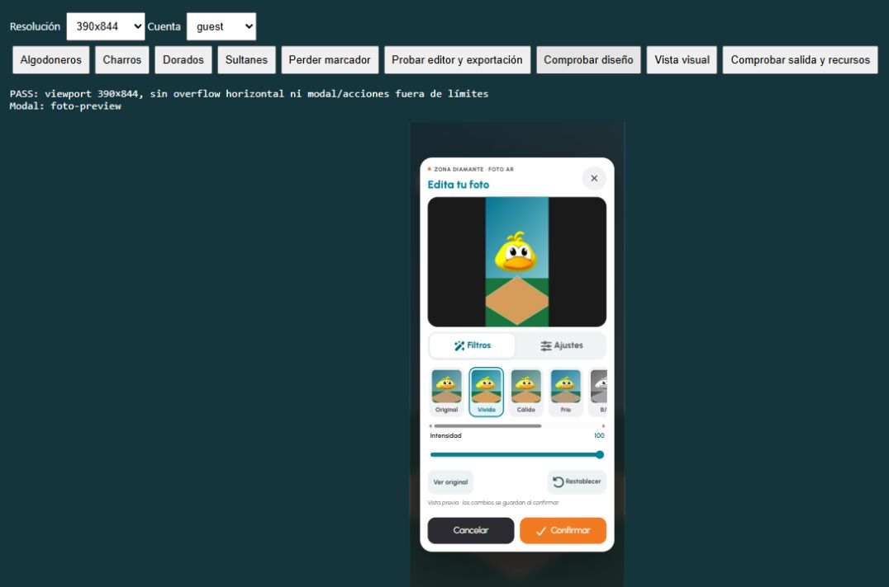
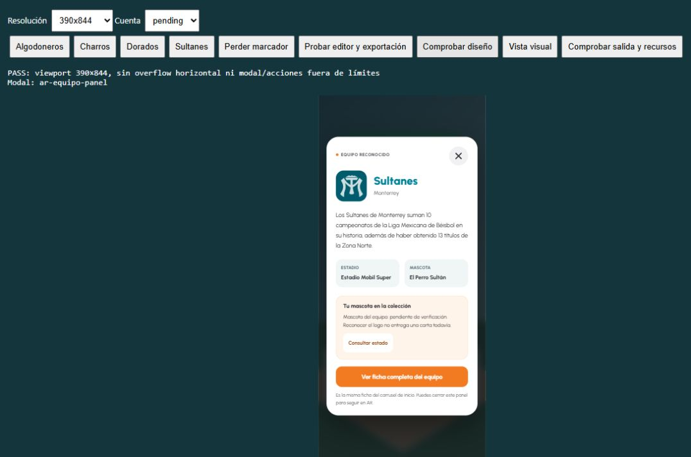

# Zona Diamante — Fase 2B: experiencia AR, mascotas y edición fotográfica

Fecha: 25 de octubre de 2026. Repositorio `D:\projects\zona-diamante`. Rama comprobada: `feat/collection-cards`; base `7e21760` (`feat(game): add secure game session lifecycle`). Árbol limpio al comenzar, salvo el aviso de Git sobre la carpeta ignorada `.pytest_cache`; no se descartó trabajo previo.

**Estado global: PARCIAL.** La consulta de inventario, infraestructura de concesión privilegiada, información contextual y editor están implementados. La concesión desde el navegador permanece deshabilitada porque MindAR no aporta evidencia verificable al servidor. No se certifica seguimiento físico ni compatibilidad iOS/Android sin pruebas en dispositivos.

## 1. Estado inicial de AR

Se contrastaron los informes de auditoría/Fases 1 y 2A con código y pruebas. La entrada pública era `pages/experiencias/camara.html`, con iframe `pages/ar/ar-vista.html`. Mostraba cuatro mascotas, permitía inspección 3D con gestos, captura, guardar/compartir y confirmación de descarte. No exigía iniciar sesión. El botón “Reclamar” y abrir el inspector disparaban confeti; no había concesión persistente ni consulta de propiedad.

La foto ya combinaba cámara y WebGL; no se sustituyó esa composición por una captura sólo de video. No había filtros/editor ni acceso contextual a las fichas de equipos.

## 2. Arquitectura encontrada

El shell SPA conserva navegación y monta/destruye el iframe para aislar cámara, workers y WebGL. `camara.js` administra seguimiento, inspector, normalización de GLB, gestos y visibilidad. `calidad-camara.js` negocia resolución/enfoque y libera streams que llegan después de desmontar. `ar-marco.js` observa diálogos y avisa al padre para que el modal cubra la navegación; el padre valida origen y ventana emisora. `foto-ar.js` compone y administra el archivo/URLs de la foto.

Backend FastAPI modular → HTTPX/PostgREST → PostgreSQL/Supabase. Identidad validada mediante Auth, acceso privilegiado exclusivamente en servidor. Catálogo/inventario en `teams/cards/user_cards`; ledger en `reward_events`; intentos en `activity_attempts`. Se mantienen las convenciones y bloqueos de Fases 1 y 2A.

## 3. Tecnologías utilizadas

A-Frame y MindAR Image Tracking vendorizados localmente, THREE/GLTFLoader integrado en A-Frame, modelos GLB y archivo de marcadores `.mind`. Canvas 2D, WebGL, ImageData, Blob/File, createImageBitmap con fallback Image.decode, requestAnimationFrame, AbortController, diálogo HTML nativo, Web Share API y descarga por enlace Blob. CSS propio de AR sobre la identidad/tipografía Urbanist existente; build Tailwind/esbuild ya instalado. No se incorporaron frameworks o dependencias npm/pip nuevas.

Iconos nuevos: sprite SVG local de Font Awesome Free **7.1.0**, descargado del [repositorio oficial](https://github.com/FortAwesome/Font-Awesome/tree/7.1.0/svgs/solid), con licencia original junto al sprite. No hay kit, CDN, token ni biblioteca global instalada.

## 4. Experiencias existentes y mapa exacto

| Índice MindAR | ID de equipo/carrusel | Modelo final | Carta mascota |
| --- | --- | --- | --- |
| 0 | `algodoneros-ul` | `Pollo_Fin.glb` | `pollo-algodonero` |
| 1 | `charros-jal` | `Straiky_Fin.glb` | `straiky` |
| 2 | `dorados-chi` | `Pancho_Fin.glb` | `pancho-pistolas` |
| 3 | `sultanes-mty` | `Perro - Fin.glb` | `perro-sultan` |

MindAR emite `targetFound/targetLost`. Se mantiene el último resultado durante 900 ms de pérdida; el inspector conserva el equipo elegido mientras sigue actualizándose el conjunto de marcadores visibles. Al cerrar vuelve al estado de tracking vigente. Los datos editoriales vienen del proveedor compartido `datos-equipos.js`, actualmente JSON local; ya admite filas `public.teams`. Las cartas y propiedad proceden de Supabase mediante la API autenticada.

## 5. Problemas identificados

- “Reclamar” comunicaba una celebración sin inventario/ledger confirmado.
- La detección local no es una prueba de presencia física: eventos y peticiones pueden falsificarse.
- No había consulta de mascota propia ni información contextual del equipo.
- La previsualización no tenía edición; los cambios CSS por sí solos no habrían servido para exportar filtros.
- El diálogo de descarte se apilaba sobre otro modal; el flujo nuevo evita esa superposición.
- La regla CSS global `video, canvas` era incompatible con canvas adicionales de edición; se acota a video de cámara y canvas de A-Frame.
- Durante la prueba real de cambios rápidos de marcador, el inspector podía quedar esperando o aplicar una carga anterior. Se comprobó en el bundle local que `gltf-model` no cancela cargas previas al cambiar `src`; se añadió control de aplicación/versiones y caché.

## 6. Diseño del desbloqueo de mascotas

Se separan cuatro hechos: **detección local**, participación observada por UI, verificación de confianza y autorización de concesión. Sólo los dos últimos pueden permitir una operación persistente. Esta fase no implementa un verificador de escaneo.

Operaciones SQL protegidas:

1. `authorize_ar_mascot(user, team_slug, verification_ref)` registra un intento AR verificado por un servicio/operador de confianza, después de validar evidencia fuera de esta función.
2. `grant_verified_ar_mascot(user, attempt, request_key)` resuelve la mascota exacta del catálogo y registra inventario + cierre del intento + evento cero puntos en una transacción.

La referencia es una identidad de auditoría, **no una prueba criptográfica ni un token entregable al navegador**. No hay ruta HTTP que llame a ninguna de estas funciones. Su disponibilidad SQL no implica que se haya verificado un escaneo o que el producto pueda conceder mascotas públicamente.

## 7. Seguridad de la concesión

Sólo `service_role` puede ejecutar autorización/concesión; PUBLIC, anon y authenticated no tienen EXECUTE. Se conserva RLS y la ausencia de escrituras directas de inventario/ledger para usuarios. Las funciones son SECURITY INVOKER con search_path explícito.

Se valida perfil, usuario propietario, tipo AR, columnas verificadas dedicadas, referencia, equipo activo y exactamente una mascota activa AR de coste cero. No se recibe card_id, saldo, puntos o propiedad del cliente. Metadata `scanned=true` no satisface autorización. El trigger `enforce_verified_ar_reward` exige correspondencia usuario/intento/equipo/carta y delta cero; impide usar la RPC genérica para acreditar puntos a un intento AR verificado. La barrera de juegos de Fase 2A continúa activa.

## 8. Backend implementado

`GET /api/v1/ar/mascots` requiere Bearer. Devuelve mascotas activas con `team_slug/team_name/card_id/card_slug/card_name/is_owned/status/browser_claim_enabled:false`. El inventario se filtra por el usuario autenticado; un parámetro `user_id` del cliente no cambia identidad. Estados: `owned` o `verification_required`.

No existen POST públicos de claim/verify/unlock/authorize. Fallos REST se traducen a 502 con mensaje seguro. Un catálogo ambiguo se rechaza. La nueva ruta y sus servicios/esquemas están separados de fotografía y de la API de colección.

## 9. Migración SQL

Única migración de esta fase: `20261025000200_verified_ar_mascot_grants.sql`.

- Añade `ar_team_id`, `ar_verification_ref`, `ar_verified_at` a intentos, con CHECK de coherencia. Las filas existentes conservan NULL.
- Unicidad de referencia y de autorización por usuario/equipo. El catálogo actual tiene una mascota por equipo; futuros cambios de temporada/catálogo necesitan revisar esta política.
- Extiende explícitamente `reward_events_v2_shape_check` para `ar_mascot_unlock`: intento y carta presentes, cero puntos. No utiliza `card_purchase`.
- Índice único de concesión AR por usuario/carta; mantiene el índice v2 por intento y la clave derivada por usuario/operación/solicitud.
- Locks perfil → intento → catálogo, coherentes con las fases anteriores. Peticiones duplicadas convergen o dan conflicto; no sobrescriben operaciones ajenas.
- Inventario existente conserva su fuente; el resultado y metadata del evento indican `already_owned`. No duplica cartas ni anuncia una nueva adquisición. Repetir la solicitud original devuelve el evento original; cambiar clave de un intento completado se rechaza.
- Trigger de integridad de concesión y permisos explícitos. Sin cambios a precios, balances, seed o migraciones históricas.

## 10. Compatibilidad con recompensas anteriores

Se conservan firmas y reglas de trivia, compra, intentos genéricos y sesiones de juego. El CHECK v2 sólo añade una forma de evento AR propia, sin relajar compras ni créditos genéricos. Los intentos AR históricos sin columnas verificadas no se convierten en autorizaciones por metadata y mantienen el contrato genérico privilegiado anterior.

Instalación limpia y actualización desde los 18 históricos pasan por el checkpoint de 20 de Fase 1, después Fase 2A y esta fase (22 migraciones). Se comparan IDs, contenido editorial, saldo, inventario y ledger previos; no se reescribe historia.

## 11. Flujo de información de equipos

“Equipo y mascota” aparece en el resultado reconocido y también en el visor 3D. Abre un único diálogo con logo, nombre, ciudad, historia breve, estadio, mascota y estado de propiedad. Reutiliza `obtenerEquipos`, sin duplicar datos deportivos.

**Aclaración del usuario aplicada:** “Ver ficha completa del equipo” abre `pages/equipos/equipo.html?id=<id>`, exactamente la ruta de “Ver más” del carrusel. Se navega en el documento superior, liberando AR; no se crea otra ficha ni se rediseñan las páginas existentes.

El panel captura el ID al abrirse. Perder/recuperar/cambiar marcador no reemplaza su contenido. Cerrar devuelve el foco al botón de origen y permite seguir en AR. Una apertura posterior usa el equipo vigente. En el inspector usa la mascota que se está inspeccionando.

## 12. Diseño de controles AR

Identidad existente: turquesa, naranja, Urbanist, tarjetas claras y esquinas redondeadas. Resultado de escaneo más compacto; botones de información/3D agrupados. Inspector con información arriba a la izquierda, cerrar arriba a la derecha, captura abajo; centro disponible para el modelo. Se retiró el confeti de las acciones sin concesión confirmada.

Propiedad: invitado puede disfrutar AR y recibe explicación de sesión; pendiente informa que reconocer no entrega carta; adquirida sólo se muestra con respuesta de inventario; error permite consultar otra vez y nunca anuncia éxito. Las variantes de cuenta de la fixture visual son simuladas y no prueban persistencia: esa persistencia se prueba aparte con PostgreSQL/Auth/PostgREST reales locales.

## 13. Arquitectura del editor

`foto-ar.js` conserva captura, archivo confirmado, guardar/compartir y descarte. Recibe una fábrica opcional de editor para mantener compatibilidad con consumidores anteriores. `editor-foto.js` administra borrador, última confirmación, comparación, herramientas y recursos. `filtros-foto.js` contiene transformación pura de píxeles y lectura/exportación Canvas.

Fuente original inmutable. Vista previa limitada a 640 px; exportación desde el original a resolución de captura (máximo 2048 por lado). No se edita sobre una versión ya filtrada. Preview y archivo final usan la misma transformación, sin filtros CSS decorativos. Original sin ajustes reutiliza el archivo original para evitar recomprimirlo.

## 14. Filtros implementados

Original, Vívido, Cálido, Frío, B/N, Vintage y Cine. Mezcla de intensidad 0–100. Cambios reproducibles de contraste/saturación/temperatura/brillo y matriz sepia para Vintage. Miniaturas procesadas del original, selección visible con aria-pressed y carrusel horizontal.

## 15. Ajustes manuales

Brillo, contraste, saturación y temperatura, rango −100 a 100, slider con etiqueta y valor visible. Herramientas separadas de filtros; sólo se muestra el ajuste elegido. Normalización de entradas evita NaN y valores fuera de rango. Se prueban cambios de píxeles en ambos sentidos para los cuatro ajustes.

## 16. Confirmar, cancelar y restablecer

Captura abre preview (`captured`). Editar abre borrador (`editing`). Confirmar procesa la foto completa y sustituye el archivo actual (`confirmed`). Cancelar edición —también X/Escape mientras se edita— vuelve a la última foto confirmada, sin descartarla. Restablecer cambia sólo el borrador a parámetros iniciales; se aplica al confirmar.

Cerrar preview pide confirmar descarte. En el flujo con editor se cierra preview antes de abrir confirmación: sólo un modal fotográfico a la vez. Conservar restaura preview. Descartar revoca URLs, limpia imágenes/parámetros y permite otra captura. Navegar fuera cancela exportaciones y libera recursos. La API antigua opcional sin editor conserva su comportamiento para no romper las pruebas/consumidores anteriores.

## 17. Guardar y compartir

Guardar usa un Blob/File JPEG ya preparado, con nombre de equipo y fecha, y una URL de descarga independiente que no se invalida al descartar preview. Compartir pasa ese mismo archivo confirmado a Web Share, preservando la activación del toque. Si compartir archivos no está disponible, el botón queda deshabilitado y se indica usar Guardar/descargas. Cancelar la hoja de compartir conserva la foto; no promete una app concreta ni confirma un envío que el navegador no acredita.

La validación de navegador compara píxeles/dimensiones del JPEG confirmado y comprueba el archivo entregado al manejador de share. La hoja real del sistema, guardar en Fotos y apps receptoras requieren dispositivo compatible; no se declaran probadas.

## 18. Compatibilidad móvil

100dvh con fallback, viewport-fit=cover en documento AR, safe-area-inset, diálogos con límites de altura y scroll interno, herramientas horizontales, controles principales de al menos 44 px y distribución en dos columnas cuando hay espacio/horizontal. No se modifica la navegación global, colección, fichas ni autenticación.

La fixture usa iframes con viewport CSS real de 360×740, 390×844, 768×1024, 1440×900 y 844×390. La vista de revisión puede escalarlos para caber en el navegador; no equivale a emular hardware, DPR, Safari o áreas seguras de un teléfono físico.

## 19. Optimizaciones

La transformación se compone una vez como matriz afín, sin crear arrays por píxel. Exportación por bloques de 48 filas cede al event loop y admite cancelación. RAF agrupa cambios del slider; versiones/AbortController descartan resultados obsoletos. Canvas temporales se vacían; ImageBitmap y object URLs se liberan.

Se pausa cámara/tracking/renderizado durante preview/editor/confirmación para evitar trabajo invisible; se reanuda al volver a AR. Al salir se detienen pistas, animaciones, sistema AR y renderer. `recursos-ar.js` también maneja inicio incompleto: el `stop()` vendorizado presupone video/controlador existentes; el adaptador garantiza limpieza independiente e invalida el video antiguo para rechazar un getUserMedia tardío. Volver desde bfcache recarga el contexto descartado. Las cargas de GLB se cachean por URL y sólo se aplica la selección vigente; se invalidan solicitudes al volver al modelo actual o perder resultado y se liberan modelos al destruir.

## 20. Pruebas automatizadas

Resultados finales: backend **111 aprobadas** (102 previas + nueve AR); frontend **64 aprobadas** (44 previas + 20 nuevas); build frontend **aprobado**; SQL **406 aserciones aprobadas** y **38 carreras reales aprobadas** entre ambos entornos, runner **exit 0**. Sin skips. Las pruebas locales previas incluyen archivos ignorados heredados; las nuevas se entregan versionables bajo `frontend/checks/`.

Una primera invocación de pytest desde la raíz falló durante colección con `ModuleNotFoundError: app`; no ejecutó tests. Se corrigió el directorio de trabajo a `backend` y se ejecutó la suite completa indicada. No se cuenta ese intento fallido como una ejecución aprobada. Docker estuvo operativo (29.8.0).

SQL por entorno: 81 Fase 1 + 63 Fase 2A + 45 AR + 14 esquema = 203. Carreras por entorno: siete económicas + siete juego + cinco AR = 19. AR comprueba autorización duplicada, misma concesión, distintas claves para el mismo intento, colisión entre equipos y misma clave en usuarios distintos; saldo permanece igual, una carta/un evento por recurso. Los 45 pgTAP cubren roles reales, propietario, equipo/mascota incorrectos, puntos prohibidos, metadata falsa, referencia/idempotencia, propiedad previa, catálogo inactivo y rollback forzado.

Se ejecuta Auth local real, FastAPI por ASGI y PostgREST sin sustituir identidad: inventario antes/después de concesión SQL privilegiada y cuatro POST públicos inexistentes. Se incluyen las 34 comprobaciones HTTP de Fase 2A por entorno. No se usa producción ni exclusivamente mocks para aceptar Supabase.

Comandos desde raíz:

```powershell
Push-Location backend
.\venv\Scripts\python.exe -m pytest -q -p no:cacheprovider
Pop-Location
Push-Location frontend
npm test
npm run build
Pop-Location
.\backend\venv\Scripts\python.exe backend/checks/phase02b_database.py
node frontend/checks/phase02b-preview.cjs
# Abrir http://127.0.0.1:4174/__review
```

El runner utiliza sólo proyectos generados bajo `.tmp`, marcadores desechables, puertos propios, sin vínculo remoto ni `.env` copiado; reset/up son locales y psql se invoca dentro del contenedor cuyo ID generó. No recibe DSN remoto. Se detienen únicamente esos contenedores; las carpetas ignoradas quedan para inspección. Advertencia existente: deprecación TestClient/HTTPX, sin actualizar dependencias.

## 21. Pruebas reales en navegador

Canvas, Blob/File, JPEG, A-Frame y GLB son reales en la fixture. Video y eventos de marcador son explícitamente simulados. El cliente backend se sustituye sólo en el servidor de revisión para estados de UI y evitar peticiones a producción. No hay flags o rutas de simulación incorporados al sitio publicado.

El botón de prueba recorre información, cambio de equipo, inspector, captura, siete filtros, intensidad, comparación, sliders, cancelación, confirmación, restauración exacta del original, píxeles B/N/brillo en archivo exportado, guardar, compartir con manejador controlado, cancelación, descarte sin modales anidados y segunda captura. Se ejecutó el conjunto final de **35 comprobaciones** a 360×740, 390×844 y 1440×900: el mismo conjunto repetido, no 105 casos distintos. La comprobación de salida observó la pista de video de la fixture en estado `ended`.

Se inspeccionó el editor y se comprobó geometría a los cinco tamaños: sin desbordamiento horizontal, modal fuera de límites o acciones superpuestas; en 844×390 se comprobó scroll interno hasta Cancelar/Confirmar. Se revisaron en pantalla invitado/pendiente/adquirida/error de red mediante respuestas simuladas, y se pulsó la ficha completa: abrió la página real de Algodoneros del carrusel. Se entró también al shell AR real, sin sustituir MindAR: agotó el timeout de cámara; el aviso y la navegación de salida funcionaron, pero esto no acredita acceso físico.

La primera ejecución se detuvo al cambiar rápido de modelo. Se corrigió carga/versiones; durante esa corrección fue necesario inicializar explícitamente `gltf-model` antes de usar su loader. Los recorridos corregidos se repiten antes de aceptar. No se contabilizan como aprobadas las ejecuciones intermedias fallidas.

## 22. Evidencia visual

Evidencias guardadas en `docs/evidencias/fase02b/`. Las capturas de editor/panel son una fixture explícita: GLB y procesamiento reales, video/reconocimiento/cuentas simulados. El iframe tiene el viewport indicado; el contenedor lo escala para caber en la ventana de revisión. No son capturas de hardware móvil ni fotografías de usuarios.

| Evidencia | Archivos |
| --- | --- |
| Editor, cinco viewports | `360-editor.png`, `390-editor.png`, `768-editor.png`, `1440-editor.png`, `844-editor.png`; sus respectivos `*-editor-layout.txt` |
| Acciones alcanzables en horizontal | `844-editor-acciones.png` |
| Panel y propiedad | `390-equipo-{invitado,pendiente,adquirida,error}.png` y `equipo-*.txt` |
| Recorridos finales completos | `360-pruebas.txt`, `390-pruebas.txt`, `1440-pruebas.txt` |
| Ficha compartida y limpieza | `ficha-carrusel-desde-ar.txt`, `salida-recursos.txt` |
| Cámara real bloqueada | `camara-real-timeout.png`, `camara-real-timeout.txt` |
| Consola observada | `consola-observacion.json` |





## 23. Pruebas no ejecutadas

Escaneo físico con logo válido; seguimiento/luz real; permisos/reanudación de cámara en teléfonos; Safari iOS, Chrome Android y áreas seguras físicas; hoja de share real y recepción en aplicaciones; guardado en galería del dispositivo; producción/historial remoto. No se dispone de un verificador defendible de presencia física.

La cámara real del navegador integrado no respondió y activó el timeout; no se declara probado un permiso concedido/denegado por hardware. Los escenarios de rechazo de permiso de la suite son unitarios. El manejo de share del recorrido es controlado, no una hoja real del sistema.

## 24. Riesgos y pendientes

La detección JS sigue siendo manipulable. No se habilita concesión pública. Debe definirse quién verifica, con qué evidencia, modelo de abuso/replay y auditoría. Un temporizador, nonce o firma de datos generados por el propio cliente no prueba presencia física. Las recompensas pueden necesitar evidencia operativa externa, validación supervisada o un proveedor de atestación con límites explícitos; una foto del logo por sí sola admite replay.

La autorización SQL confía en `service_role`; no sustituye la protección de credenciales/verificador. El catálogo actual supone una mascota activa por equipo y autorización única usuario/equipo: temporadas o sustitución de mascotas requieren diseñar versionado. No se migraron autorizaciones a partir de metadata previa.

Los tamaños grandes están acotados, pero uso de memoria, permisos, cámara y WebGL deben validarse en hardware objetivo. Las fuentes editoriales locales no se actualizaron ni se certificó vigencia de estadísticas deportivas.

**Consola: revisión final del 25 de octubre:** el mismo `TypeError: Failed to execute 'observe' on 'MutationObserver': parameter 1 is not of type 'Node'` se reprodujo en revisión, shell real y un iframe con HTML retrasado que contiene cero scripts tanto en padre como en hijo. Este último caso demuestra que AR/A-Frame/MindAR no son necesarios para esa reproducción y apunta al entorno de inspección del navegador integrado. No se obtuvo la pila de ese contexto externo ni se atribuyen automáticamente todos los eventos históricos a él. Las 225 llamadas interceptadas en la página fueron válidas; la consola integrada sigue conservando el error. No se parcheó el producto por suposición. Informe, límites y pasos de depuración externa en [fase-02b-validacion-observer.md](fase-02b-validacion-observer.md); evidencia adicional en `evidencias/fase02b/revision-observer/`.

**Conciliación editorial pendiente:** el JSON reutilizado llama a la mascota de Charros “El Charro” y a la de Dorados “Dorado”; el catálogo de cartas AR utiliza “Straiky” y “Pancho Pistolas”. Se preservó la información de las fichas solicitadas y no se inventaron datos deportivos. El inventario/concesión siempre resuelve la carta del catálogo por equipo, no el texto editorial. El equipo debe conciliar esos nombres si deben representar el mismo personaje.

## 25. Decisiones técnicas

Reutilizar intentos e inventario; no añadir una tabla paralela de recompensas. Columnas verificadas dedicadas frente a metadata del cliente. Separar autorización de concesión y dejar ambas fuera de rutas públicas. Usar evento AR propio y cero puntos. Datos/ficha de equipo compartidos. Editor nativo en navegador, sin servidor de fotos ni biblioteca adicional. Caché y aplicación versionada del glTF sin modificar el bundle histórico de A-Frame/MindAR.

## 26. Archivos creados y modificados

Backend: nuevos `app/api/routes/ar.py`, `app/schemas/ar.py`, `app/services/ar.py`, `tests/test_ar.py`, `checks/phase02b_database.py`; modificado `app/main.py`.

SQL: nueva migración `20261025000200_verified_ar_mascot_grants.sql` y `tests/database/phase02b_ar_test.sql`.

Frontend: nuevos `contexto-equipo.js`, `filtros-foto.js`, `editor-foto.js`, `carga-modelo.js`, `recursos-ar.js` en features/ar; sprite/licencia Font Awesome en assets; pruebas/fixture/servidor/recorrido en `frontend/checks/{ar-editor.test.mjs,ar-fixture.js,phase02b-preview.cjs,phase02b-browser.js}`. Modificados `camara.js`, `foto-ar.js`, `css/camara-foto.css`, `pages/ar/ar-vista.html` y la versión del iframe en `pages/experiencias/camara.html`. Se versionan las referencias HTML/CSS/entrada AR y la importación de foto-ar para reducir mezcla de activos anteriores.

Documento actual y evidencias. Salidas de build ignoradas regeneradas. Sin cambios de package/lockfiles, configuración secreta, HTML/CSS de colección/fichas, lógica de trivia/juego o migraciones históricas.

## 27. Migraciones pendientes de aplicación

Remoto: **toda la migración nueva sigue pendiente**. Antes de un rollout autorizado: respaldo y revisión del historial, comprobar Fases 1/2A, revisar homónimos y catálogo/duplicados, ejecutar runner local completo y aplicar únicamente el archivo nuevo por el proceso del equipo. Nunca reset remoto, renombrar historia ni corregir borrando ledger/inventario.

Después, verificar permisos/trigger/índices y lectura autenticada con cuentas de prueba. Mantener concesión pública deshabilitada; no desplegar un endpoint basado en `marker_found`. Iniciar el backend nuevo después del esquema, invalidar activos AR en el despliegue autorizado y revisar en dispositivos. Fallos se corrigen hacia adelante. Este procedimiento no se ejecutó en producción.

## 28. Guía manual

1. Arrancar servidor local normal para cámara real; usar HTTPS/localhost y dispositivo con cámara. Para revisión sin hardware, abrir la fixture explícita y recordar que no acredita escaneo.
2. Reconocer cada equipo, perder/recuperar logo, abrir información, cambiar marcador y verificar snapshot. Comprobar la ficha compartida del carrusel y volver a AR.
3. Verificar invitado/pendiente/ya adquirida/error sin confeti de recompensa. Consulta autenticada requiere API/migración disponible; ninguna variante concede por POST del navegador.
4. Abrir 3D, girar/mover/zoom; capturar. Editar filtros/intensidad y cuatro ajustes; comparar, cancelar y confirmar. Reabrir, restablecer y confirmar Original.
5. Guardar y revisar el archivo en otra aplicación; compartir cuando el dispositivo lo permita. Cancelar share y conservar foto; descartar y capturar otra vez.
6. Revisar cuatro resoluciones requeridas y horizontal, teclado/foco/Escape, scroll, áreas seguras y error/denegación de cámara.
7. Navegar fuera durante edición/carga; comprobar cámara apagada, ausencia de estados residuales y nueva inicialización al volver.

## 29. Checklist de aceptación

- [x] A: auditoría, consulta autenticada, concesión privilegiada, SQL/permisos/idempotencia/atomicidad/concurrencia y regresiones.
- [x] A: solicitudes arbitrarias del navegador no conceden mascotas; no se descuentan puntos.
- [x] B: fuente editorial/ficha compartida con carrusel, panel estable y cierre; pruebas de estado y navegador.
- [x] C: original inmutable, filtros/ajustes, confirmar/cancelar/restablecer, exportación de píxeles y gestión de recursos.
- [x] D: revisión de las cinco resoluciones, estados de cuenta y geometría; evidencias guardadas.
- [x] E: suites/build, SQL/concurrencia y evidencias de recorridos ejecutados.
- [x] E: las 21 migraciones históricas coinciden con `7e21760`; colección/fichas/dependencias sin cambios versionados.
- [x] Entornos Supabase desechables detenidos, pestañas de prueba cerradas y servidor propio 4174 detenido; no se detuvieron servicios previos del usuario.
- [x] Reproducir y aislar el TypeError en un iframe sin código de producto ni dependencias; conservar consola/trazas sin ocultar errores.
- [ ] Obtener pila del contexto externo y contrastar Chrome/Safari externo antes de aprobación de producción; la consola integrada aún registra el error.
- [ ] Verificador de escaneo y concesión pública (deliberadamente bloqueados).
- [ ] Cámara/seguimiento/share en dispositivos físicos.
- [x] Sin commit, push, merge, cambio de rama, despliegue, SQL remoto o modificación de usuarios reales.

## 30. Integración posterior con colección

No se rediseñó colección. Su futura UI debe consumir propiedad del servidor, respetar mascotas AR de coste cero no comprables, distinguir estado pendiente de propiedad confirmada y refrescar catálogo/inventario al regresar. Una animación/confeti o detección local no debe desbloquear visualmente cartas como si fueran persistentes. La integración pública de premios requiere el verificador y pruebas de autorización adicionales antes de habilitar rutas de escritura.

## 31. Validación final de MutationObserver

La revisión posterior conservó los cambios existentes y confirmó rama `feat/collection-cards`, base `7e21760`. Se añadieron únicamente herramientas locales de diagnóstico/aislamiento, un recorrido de ciclos de iframe y documentación. No se modificó el código de producto, las librerías vendorizadas, el diseño aprobado, colección, backend ni SQL durante esta revisión. El diagnóstico requiere `--observer-trace` y no se incorpora a las páginas publicadas; conserva el retorno y las excepciones nativas.

Se repitieron **68 pruebas frontend aprobadas** (64 existentes + cuatro del diagnóstico), **111 backend aprobadas**, build y `git diff --check` sin errores. En navegador se repitió el conjunto de 35 comprobaciones del editor/exportación tres veces a 390×844 y pasaron **14 comprobaciones nuevas de ciclos**, además de salida con una pista de video de fixture terminada. El shell real permitió salida/reentrada SPA y terminó en timeout de cámara; no acredita hardware. No se repitieron SQL/concurrencia ni toda la matriz visual: sus cifras anteriores siguen siendo históricas de la implementación, no nuevas ejecuciones de esta revisión.

El mismo TypeError aparece sin scripts en padre/hijo cuando el cuerpo del iframe llega un segundo después. La consola original y la final se conservan sin filtros; no se declara corregido un error interno del navegador ni limpia su consola. La comparación y pila en navegador externo siguen pendientes. **Se recomienda continuar integración local y revisión; la aprobación de producción conserva esas verificaciones y las físicas/recompensas ya pendientes.** El detalle reproducible, inventario de cinco sitios de llamada, trazas y limitaciones está en [fase-02b-validacion-observer.md](fase-02b-validacion-observer.md).
